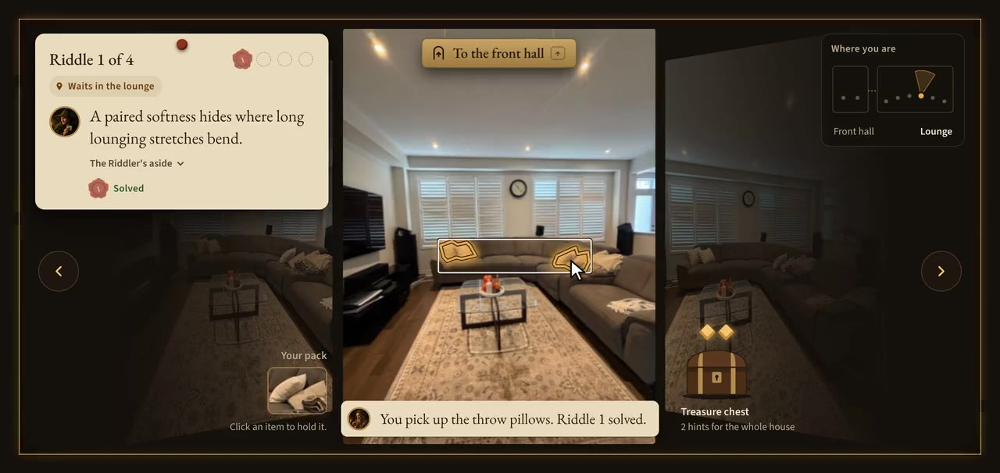
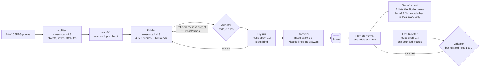

# Keyframe

**Meta Global AI Developer Hackathon (Cerebral Valley), Oct 26 to Nov 4, 2026.**
**Indie track, solo: Luis Ticas.**

Photograph a room, and about three minutes later you are playing an
escape room built from your own objects, hosted by four wizards that
Meta's models play.

## For judges

**Live site:** https://luis-ticas1--keyframe-web.modal.run.
The sample room needs no code; Build your own needs the access code given in the submission.

1. **Open the site.** The first visit plays a short intro ("Skip intro" or Escape ends it). The page opens on three cards: Watch the demo, Play the sample room, Build your own.
2. **Play the sample room.** Choose "Play this room". The wizards' intro tells the story (the Architect welcomes you, the Trickster locks you in, the Riddler counts the riddles, the Guide lights the treasure chest). Then solve the four riddles one at a time: walk around the room with Turn left and Turn right, click the outlined objects, and open the chest when you are stuck. It holds two hints for the whole game. Solving the last riddle opens the door.
3. **Or build a room from 6 to 10 photos.** Enter the access code and upload 6 to 10 JPEG photos of one room. The build takes about three minutes. Then open the Build view to see every model call, the object outlines, the Validator's verdict on each of its eight rules and the blind Dry run. The sample room's own Build view is at [#/build/job_01M61TZ74F6F3AVVEMPRAS4V1G/view](https://luis-ticas1--keyframe-web.modal.run/#/build/job_01M61TZ74F6F3AVVEMPRAS4V1G/view).



*A frame from the play-through recorded on the live site (story mode, the sample room).*

One container is kept warm during judging, so the first visit should not hit a cold start.

## Where each Meta model is used

| Model id | What it does in Keyframe | Where it runs | Status | Call site |
|---|---|---|---|---|
| `muse-spark-1.3` | **The Architect** lists the objects a player could click in the photos, with a box, 2 to 4 visible attributes and each photo's area. **The Riddler** writes 4 to 6 linked puzzles, each with a clue, lore and three hints in the Guide's voice. **The Dry run** plays the room blind from the photos, clues and hints. **The Storyteller** writes the wizards' lines for this room. **The live Trickster** proposes one bounded change to the room during play. | Meta Model API. The first four run during every Build, on the hosted site and in local mode. The Trickster runs live during play on the hosted site, with the cache off. | Shipped | [src/config.py#L65](src/config.py#L65), [src/council/](src/council/) (`architect.py`, `riddler.py`, `dryrun.py`, `storyteller.py`, `trickster.py`), [src/providers/meta_api.py#L53](src/providers/meta_api.py#L53) |
| `sam-3.1` | One segmentation call per object the Architect found, on that object's clearest photo. The masks become the clickable outlines you see in play and under "Show all objects". | Meta Model API, during every Build (hosted site and local mode) | Shipped | [src/pipeline/segment.py#L56](src/pipeline/segment.py#L56), [src/providers/meta_api.py#L54](src/providers/meta_api.py#L54), [src/domain/masks.py](src/domain/masks.py) |
| `muse-image-1.0` | Painted the four wizard portraits (Architect, Riddler, Guide, Trickster). | Once, at build time: `scripts/portraits.py` made one call per wizard on Oct 27, and the results are committed under [web/public/portraits/](web/public/portraits/). Play never calls it. | Shipped (portraits only) | [scripts/portraits.py](scripts/portraits.py) |
| `llama3.2:3b` (Llama 3.2 3B on Ollama) | Rewords a hint in the Guide's voice and greets a returning player. If Ollama does not answer within 5 s, the hint is shown as written. | Local mode only, on the player's own machine. The hosted site refuses `GUIDE=ollama` and shows hints exactly as the Riddler wrote them. | Shipped (local mode only) | [src/providers/ollama.py#L32](src/providers/ollama.py#L32), [src/config.py#L76](src/config.py#L76) |

**How the personas are made.** The Architect, Riddler, Dry run, Storyteller
and Trickster are one model, `muse-spark-1.3`, used through role prompting,
not training or fine-tuning. Each role has its own system prompt, its own
inputs, its own reasoning effort (medium for the Riddler, low for the rest)
and its own JSON reply schema. The hand-offs between them are pipeline
stages, not agents talking to each other. What each role may see is
enforced in code:

- The Architect gets only the photos.
- The Riddler gets the objects (id, label, attributes, photo), never a photo.
- The Dry run gets the photos, the object names and each puzzle's clue and hints, never a solution.
- The Storyteller gets only the room's name, area labels, counts and the labels of objects no puzzle uses.
- The Trickster gets `RoomView` and a summary of the game state. `RoomView` is the only type a prompt builder accepts, and it has no solutions and no evidence ([src/domain/schema.py](src/domain/schema.py)).

The Trickster and the Storyteller never see an answer.

The Guide has no model call of its own on the hosted site. Its hints are
written by the Riddler call, its chest and closing lines by the
Storyteller, and code decides which hint opens.

## What shipped and what did not

**Tier 1 shipped. Tier 2 and Tier 3 did not ship.**

The plan had three tiers: Tier 1 is the game played over the photos of your room, which shipped; Tier 2 would have rebuilt the room's objects in 3D; Tier 3 would have added a photoreal 3D shell of the whole room.

Shipped:

- **Story mode, the default.** A five-beat intro written for each room, riddles one at a time in the riddle note, walking around the room area by area, and the Guide's treasure chest with 2 hints for the whole game. A hint opens only when you ask; none opens by itself.
- **The build pipeline.** It runs `ingest`, `architect`, `segment`, `author`, `validate`, `dryrun`, `story` and `scene` ([src/pipeline/build.py](src/pipeline/build.py)). A draft the Validator refuses goes back to the Riddler with the reasons, never the draft, at most twice ([src/pipeline/regenerate.py](src/pipeline/regenerate.py)). The sample room really was sent back once, for rule 5, and passed on its rewrite.
- **The Validator: eight rules in code, no model** ([src/domain/validator.py#L40](src/domain/validator.py#L40)):
  1. No two locks wait on each other.
  2. Every lock can be reached.
  3. Every puzzle names something in this room.
  4. Every puzzle cites something the Architect saw.
  5. No hint, clue or evidence gives an answer away.
  6. Lore and hints keep to the length rules.
  7. Every lock has a valid shape.
  8. Every needed item can be picked up first.

  During play, every Trickster proposal is checked against bounds and rules 1 to 9 (rule 9: false evidence follows the decoy rules) before it changes anything. A refused proposal is shown to the player as refused.
- **Leak checks.** No answer reaches a prompt that should not have one (`RoomView`). Rule 5 checks every hint, clue and piece of evidence against every answer. Every story line is checked the same way: a line that gives an answer away is sent back once, then replaced by its template line. A sentinel test checks that the Build view and its JSON never hold a solution.
- **The hosted site** on Modal. Its limits are 20 builds in total on the access code and a $20 hosted spend cap, and every paid call is checked against the cap first. Every hosted screen carries a disclosure line, and the retention text is below. There is also a Build view for every room.
- **Local mode.** The Guide's hints are reworded with Llama 3.2 3B, and your player profile is a JSON file on your computer. The hosted site keeps no profile.

Planned and not shipped:

- **SAM 3D Objects** (Tier 2: objects rebuilt in 3D through fal.ai). Its Mon Nov 2 gate was never run, and no code calls it.
- **Muse Voice Transcribe** (asking the Guide by voice). Not built.
- **Tier 3** (a Gaussian-splatted photoreal shell). Not built.
- Images beyond the four portraits. Muse Image paints nothing else.

**Demo room disclosures.** The sample room was built live on Oct 28 by
the pipeline (18 model calls, about $0.17, 182 s). It was then
hand-corrected through the `patch-demo-room` ops action: some object
outlines were retraced or moved to a better photo, the photos' areas and
pans were seeded by hand, and the Guide's chest line was set to the
template line. Its story was written by `muse-spark-1.3` on Oct 30. The
details and run numbers are under [Hosted mode and ops](#hosted-mode-and-ops).
The Build view shows the build as it ran.

**Results so far.** The offline suite passes in a fresh clone with no
keys: about 2935 passed and 17 skipped. Live system tests SIT-01, 02, 04,
06, 07, 14 and 15 passed against the Meta Model API. SIT-03 and SIT-13
failed on the real photos when run from the cloud container, whose proxy
cuts any response at about 30 s; this was not a Meta error. The other
cases were not run. The
[SIT run log](docs/implementation-artifacts/sit-checklist.md#run-log)
records each run. The UAT acceptance tests were not run.

## How it was built

The project was planned with the BMAD Method before kickoff, then built
story by story against those documents. Every link below is in this repo.

| Artifact | What you learn there |
|---|---|
| [Product brief](docs/planning-artifacts/briefs/brief-Keyframe-2026-10-20/brief.md), with [addendum](docs/planning-artifacts/briefs/brief-Keyframe-2026-10-20/addendum.md) and [schema v1](docs/planning-artifacts/briefs/brief-Keyframe-2026-10-20/schema-v1.md) | The idea, the player and the wizard council; the technical depth; the first Room schema. |
| [PRD](docs/planning-artifacts/prds/prd-Keyframe-2026-10-21/prd.md) | The functional requirements and success measures, with the reconcile and review passes beside it. |
| UX contract: [DESIGN.md](docs/planning-artifacts/ux-designs/ux-Keyframe-2026-10-21/DESIGN.md), [EXPERIENCE.md](docs/planning-artifacts/ux-designs/ux-Keyframe-2026-10-21/EXPERIENCE.md), [mockups](docs/planning-artifacts/ux-designs/ux-Keyframe-2026-10-21/mockups/) | How it looks: tokens, type and a contrast table that the tests enforce. How every screen behaves. HTML mockups of the play, capture, build and completion screens. |
| [Architecture spine](docs/planning-artifacts/architecture/architecture-Keyframe-2026-10-21/ARCHITECTURE-SPINE.md) | The numbered decisions (AD-n) the code cites, such as AD-3 (answer-free views) and AD-6 (spend), with adversarial reviews in [reviews/](docs/planning-artifacts/architecture/architecture-Keyframe-2026-10-21/reviews/). |
| [epics.md](docs/planning-artifacts/epics.md) | The ten epics and their stories, each with acceptance criteria. |
| [Sprint status](docs/implementation-artifacts/sprint-status.yaml) | Which stories are done and which stayed in the backlog (Tier 2, voice, clue cards). |
| [SIT checklist](docs/implementation-artifacts/sit-checklist.md) and its [run log](docs/implementation-artifacts/sit-checklist.md#run-log) | The live integration cases against the real APIs, each with its cost, and what happened on each run. |
| [UAT acceptance tests](docs/implementation-artifacts/uat-acceptance-tests.md) and [sign-off record](docs/implementation-artifacts/uat-signoff.md) | UAT-01 to UAT-16, the user-level tests, including the judge's repo walkthrough. |
| [CHANGELOG.md](CHANGELOG.md) | What changed each day, Oct 26 to Nov 4, with deploy and ops run numbers. |
| [Spend ledger export](spend/exports/ledger-2026-10-28.json) | The spend log as exported on Oct 28: each paid model call to that date with its cost, and the local and hosted totals against the ceiling. |
| [Correct-course record](docs/planning-artifacts/sprint-change-proposal-2026-10-29.md) | Every departure from the plan, every live deploy and ops run, and the spend, kept honestly, with open follow-ups in section 7.2. |
| [Specs](docs/specs/spec-keyframe/SPEC.md): [stack](docs/specs/spec-keyframe/stack.md), [budgets](docs/specs/spec-keyframe/budgets.md), [delivery plan](docs/specs/spec-keyframe/delivery-plan.md), [glossary](docs/specs/spec-keyframe/glossary.md), [player profile](docs/specs/spec-keyframe/player-profile.md) | The condensed spec: which model runs where, the money and time budgets, the delivery plan, the shared vocabulary. |
| The author's own Claude Code skills under [.claude/skills/](.claude/skills/) | Five project skills, each a SKILL.md with references and a self-check script. See the list below. |
| [BMAD Method install](_bmad/) under `_bmad/`, with its skills in `.claude/skills/bmad-*` | The third-party planning method used for every document above: version 6.12.4 per [_bmad/_config/manifest.yaml](_bmad/_config/manifest.yaml). Its license is under [Licenses](#licenses). |

The five project skills:

- [keyframe-muse](.claude/skills/keyframe-muse/SKILL.md): calls Muse Spark 1.3 and Muse Image 1.0 on the Meta Model API: JSON-schema replies, image parts, reasoning effort, retries and spend pricing.
- [keyframe-sam31](.claude/skills/keyframe-sam31/SKILL.md): calls SAM 3.1 on the Responses API and turns its streamed masks into hotspot polygons.
- [keyframe-sam3d-fal](.claude/skills/keyframe-sam3d-fal/SKILL.md): calls SAM 3D Objects on fal.ai for the Tier 2 room. It was written for Tier 2, which did not ship.
- [keyframe-modal](.claude/skills/keyframe-modal/SKILL.md): hosts the judge URL on Modal, covering the web function, the spawned builds, the Dicts, the Volume, the crons and the Secret.
- [keyframe-devops](.claude/skills/keyframe-devops/SKILL.md): keeps environments and dependencies reproducible: uv and npm lockfiles, `scripts/check.sh`, `scripts/doctor.py` and the pre-deploy checks.

**What predates kickoff.** The brief, PRD, UX contract, architecture
spine, epics, specs, SIT and UAT documents, sprint status, the five skills
and the BMAD install were first written Oct 20 to 22. They are all in the
[`pre-hackathon-baseline`](https://github.com/lutic1/meta-hackathon-2026/tree/pre-hackathon-baseline)
tag. They were kept up to date through the week as the build changed:
the UX contract, architecture spine, epics and the brief through Oct 31,
and the specs and SIT checklist through Oct 30. The correct-course
record was started during the hackathon, on Oct 29.

## Architecture



The Python server ([src/api/app.py](src/api/app.py)) serves the
`/api/*` routes and the built web client. The domain code in
[src/domain/](src/domain/) is pure: the schema, the Validator, sessions,
hints and Trickster edits. The model adapters in
[src/providers/](src/providers/) sit behind one interface, with a
deterministic mock for tests. The hosted entry is
[src/api/modal_app.py](src/api/modal_app.py). The client in
[web/](web/) is Vite, TypeScript and three.js.

## Run it locally / verify without keys

You need Python 3.13 with uv 0.11.32 or newer (`.python-version`,
`uv.lock`) and Node 24 (`.nvmrc`, `web/package-lock.json`).
`python3 scripts/doctor.py` checks the machine. None of these commands
needs a key, and none of them calls a paid API:

```bash
uv sync --locked
uv run pytest -q                       # offline; expect about 2935 passed, 17 skipped
cd web && npm ci && npm run build && cd ..
MODEL_PROVIDER=mock uv run scripts/load_fixtures.py   # two synthetic fixture rooms under rooms/ (git-ignored)
MODEL_PROVIDER=mock GUIDE=verbatim uv run uvicorn src.api.app:app
# open http://127.0.0.1:8000
```

`MODEL_PROVIDER=mock` runs every model role on the deterministic mock, so
a local Build from your own photos also works without a key. Its call rows
name the `mock` host, never a live one. The test suite blocks every
non-loopback socket. A smoke call on the mock:

```bash
MODEL_PROVIDER=mock uv run python main.py chat "You are the Riddler. Greet the player."
MODEL_PROVIDER=mock uv run python main.py image "portrait of a wizard game master"
```

For the dev server: `cd web && npm run dev` proxies `/api/*` to uvicorn
on 127.0.0.1:8000.

**Live builds (optional, paid).** Copy `.env.example` to `.env`, then set
`MODEL_PROVIDER=meta` and `MODEL_API_KEY`. A live Build costs about $0.17
and takes about three minutes. Local mode's spend cap defaults to $60
(`SPEND_CAP_USD`). For the Guide's local phrasing, run Ollama with
`llama3.2:3b` and leave `GUIDE` unset. These keys are also useful:

- `MODEL_ARCHITECT`, `MODEL_RIDDLER`, `MODEL_DRYRUN`, `MODEL_STORYTELLER`, `MODEL_TRICKSTER` and `MODEL_IMAGE`: per-role model ids, default `muse-spark-1.3`, and `muse-image-1.0` for images.
- `PROVIDER_<ROLE>`: overrides `MODEL_PROVIDER` for one role.
- `HINT_POLICY`: `chest`, the default, opens hints only from the treasure chest, `HINT_CAP` per Session (default 2). `ladder` brings back the idle and wrong-attempt hints from before story mode.
- `DEMO_TRICKSTER` and `DEMO_PROPOSALS_DIR`: replay recorded or authored Trickster proposals (`scripted`, `authored`, `record`). Unset, the proposals dir is `proposals/` at the repo root.
- `HOSTED_SPEND_CAP_USD`: the hosted allocation, described below.

Run `uv run scripts/load_fixtures.py` before playing locally if you want
the fixture rooms. [docs/MONDAY.md](docs/MONDAY.md) is the kickoff
checklist used before the first paid call.

**Input.** Each Build takes 6 to 10 JPEG photos of one room. On an iPhone,
set Settings > Camera > Formats to Most Compatible before shooting. HEIC
and PNG photos are rejected. Each photo can be at most 20 MiB, and its
1280 px downscale at most 2 MiB. A larger photo is refused with 413
`upload_too_large` before anything is stored.

## Privacy and retention

The site serves the Retention summary from
[src/api/meta.py](src/api/meta.py). Both modes start with this sentence:

> Building a room sends your photos and the puzzle text to the Meta Model API. Keyframe uses its Standard service, whose terms prohibit training on this content but permit retention, including for service operation, security, safety and policy review; it is not zero retention, which needs separate enablement.

Local mode then says:

> Your player profile and room files stay on this computer until you delete them.

Hosted mode (the judge site) says:

> Photos of a room you build on this site, and the room itself, are stored on its hosted volume and are scheduled for deletion after judging, on Tue Nov 10. Play sessions are deleted 24 hours after their last move.

Raw room photos are never committed; only screenshots, clips and portraits ship.

## Known limitations

- On the hosted site, hints come exactly as the Riddler wrote them. No live model rewords them there; Llama 3.2 3B runs in local mode only.
- Uploads must be JPEG. HEIC and PNG are rejected.
- The access code allows 20 builds in total, and the hosted spend cap is $20. Once either runs out, new Builds stop. Once the cap is reached, the Trickster also stays quiet.
- A build takes about three minutes.
- Under the 2-hint chest, the Trickster's "loosen" and "decoy" proposals are always refused, so only "merge" and "shortcut" can be accepted. Its first card needs at least 3 minutes of play and an opened lock.
- If you reload the escape page (`#/done/...`), the exit door shows unlit.
- A room you build yourself can have a story that mixes model-written lines with template lines. Its Architect welcome may echo the prompt's example ("mugs and all").
- Some landing copy predates story mode. The Play card's back says "Stuck? Ask the Guide for a hint.", and the Guide's cast line says "Ask as often as you like", although the chest holds 2 hints.
- On the site, Watch the demo plays the 1:48 play-through clip.
- Accessibility follow-ups: the intro's sound button names the action rather than the state and has no `aria-pressed`, and clicking the story intro's backdrop drops keyboard focus.
- The sample room carries disclosed hand corrections ([above](#what-shipped-and-what-did-not)).

The full list of open follow-ups is section 7.2 of the
[correct-course record](docs/planning-artifacts/sprint-change-proposal-2026-10-29.md).

## Pre-existing code

Before kickoff, this repo held a model-provider scaffold of about 400
lines of Python: `main.py`, `src/config.py`, `src/providers/` (the
interface, a mock and a Meta Model API stub) and one test file. It also
held the planning documents, the five project skills and the BMAD install
listed under [How it was built](#how-it-was-built). None of it was
product code. That state is tagged
[`pre-hackathon-baseline`](https://github.com/lutic1/meta-hackathon-2026/tree/pre-hackathon-baseline)
(annotated, commit `2f740b3`, Mon Oct 26 16:32 UTC). Everything else,
including the pipeline, the wizard council, the Validator, the web game
and the hosted site, was built Oct 26 to Nov 4.
`git diff --shortstat pre-hackathon-baseline..d1ccd15` (the last commit before
the submission clean-up) gives: 498 files changed, 86386 insertions(+),
1115 deletions(-). To see the up-to-date numbers, run
`git diff --shortstat pre-hackathon-baseline..HEAD`.

## Licenses

- **Keyframe** (this repo's code and documents): MIT, see [LICENSE](LICENSE).
- **`sam-3.1`**: Meta's SAM License.
- **`llama3.2:3b`**: the Llama 3.2 Community License. Built with Llama.
- **Muse Spark, Muse Image and SAM 3.1 through the Meta Model API**: the Meta Model API terms, https://dev.meta.ai/legal/terms-of-service.
- **Bundled fonts** (EB Garamond, IBM Plex Mono, Source Sans 3): SIL Open Font License 1.1. The license files are in [web/public/fonts/](web/public/fonts/).
- **BMAD Method** (`_bmad/`, `.claude/skills/bmad-*`): third-party, version 6.12.4. No license file ships in the `_bmad/` folder. BMAD Method is published by its authors under the MIT License (https://github.com/bmad-code-org/BMAD-METHOD). `.claude/skills/modal/` is Modal's own published skill. Neither is covered by this repo's license.
- Dependencies keep their own licenses (see `uv.lock` and `web/package-lock.json`).

---

The sections below are reference material for operators and for anyone
who wants the full detail.

## How a room plays

Story mode became the default by the owner's decision on Oct 29.
"Play this room" starts a Session and opens the story intro on the Scene:
five beats in one speech box that stays in one place.

1. The Architect's welcome. It thanks a player for their own photos, or, in a Demo room, welcomes a visitor to someone else's.
2. The Trickster's trap: "Oh no, you seem to be trapped!", with the lock's seal on the way out.
3. The Riddler's entrance, counting the riddles.
4. The Guide lighting the treasure chest with the Room's chest line, else "Stuck? I keep 2 hints for the whole house. Choose your moment."
5. The Riddler again, on the first riddle's photo, with "Start looking".

The intro waits for the Scene's first photo (at most 4 s), plays once per
Session start, and "Skip intro" ends it. When play starts, the Trickster's
bubble over the chest says "2 hints, for the whole house. Spend them like
they're mine."

The riddles then come one at a time in the riddle note ("Riddle 1 of 4").
Each opens on its start photo with a line saying where it waits. You walk
around the room area by area with Turn left and Turn right, the arrow keys
or the photo's edges, instead of a thumbnail strip, and "Show all objects"
outlines everything in view. A Puzzle's evidence card reaches the play
screen only once its lock is open.

The chest holds 2 hints for the whole game (`HINT_CAP`). Each one you ask
for opens the next hint for the riddle you are on, an empty chest says
so, and nothing opens by itself. Under the chest, the Trickster's loosen
and decoy proposals are refused.

Solving the exit opens the door into daylight. "Step outside" docks the
escape sheet over the exit photo, which stays lit, with the stats, the
wizards' closing lines and Details. A cold reload of the escape page,
`#/done/<session>`, still opens on the older path, without the lit door;
this is a follow-up.

Every line comes from the room's own story (`Room.story`, served on the
play projection). A room built before story mode has a null story and
gets the fixed template lines, filled from its data.

**The generated story.** A Build runs a `story` stage after the Dry run
and before `scene` ("Writing the story" on the Build progress screen). It
is one `muse-spark-1.3` call (role `storyteller`, reasoning low). The
call gets a brief of the room's name, area labels, counts and scenery
labels, never a solution. It writes the intro beats, an opening and a
solved line per riddle, and the closing lines.

Each line must pass the story's line rules:

- No solution, target, item, evidence or code word, except the room's name and area labels.
- At most 160 characters.
- No exclamation mark except in the trap line.
- No filler words.
- The chest line counts the hints, and the Riddler's entrance counts the riddles.
- The exit's solved line opens the way out.
- The visitor's welcome thanks nobody for photos.

A reply that fails is sent back once with its reasons. After that, every
passing line of the last usable reply is kept, and only the refused slots
take the fixed templates, so the story never ends a Build. The lines are
stored with the Room (`story.json`, then `Room.story`), and the call is
cached and priced in the ledger like any Build call.

## Repo layout

```
main.py                    smoke CLI (chat / image) on whichever provider MODEL_PROVIDER names
src/config.py              Settings: the one place that reads the environment / .env
src/api/                   the FastAPI app, the Modal entry, wiring, /api/meta (disclosures, retention)
src/council/               the role prompts: architect, riddler, dryrun, storyteller, trickster, greeting
src/pipeline/              the Build stages (ingest to scene) and the regeneration loop
src/domain/                schema, Validator, sessions, hints, Trickster edits, masks, ledger
src/providers/             the ModelProvider interface, the Meta Model API adapter, mock, Ollama, cache, spend
src/infra/                 local and Modal storage adapters
web/                       Vite + TypeScript + three client; builds into web/dist
tests/                     offline tests (conftest blocks every non-loopback socket)
scripts/check.sh           pre-push check and the whole CI job (--predeploy before modal deploy)
scripts/doctor.py          Mac and cloud environment check, stdlib only
scripts/portraits.py       the one-time Muse Image portrait run
scripts/sit.py             the live SIT runner (paid; behind the spend cap)
.github/workflows/ci.yml   one job, check: runs scripts/check.sh on pushes to master
                           and keyframe/** branches and on pull requests
.github/workflows/deploy.yml  from the Actions tab or a push of a master commit to deploy/main,
                           deploy/main-warm or deploy/dev: check.sh --predeploy, then modal
                           deploy with the Modal token from the Actions secrets
.github/workflows/ops.yml  the ten ops actions (Hosted mode and ops below), from the Actions
                           tab or a push to ops/** of one .github/ops/request.json commit
                           on top of master
docs/                      planning and implementation artifacts (How it was built, above)
_bmad/                     BMAD Method v6.12.4 install (third-party)
.claude/skills/            the five keyframe-* project skills, the bmad-* skills and Modal's skill
```

## Contributing

Run `bash scripts/check.sh` before every push. It is the whole CI job
(`.github/workflows/ci.yml`, one job named `check`, on every push to
master or a `keyframe/**` branch and on every pull request). It runs:

- the privacy check
- `uv lock --check` and `uv sync --locked`
- the offline `pytest` suite
- the wheel check for macOS arm64 and Linux x86_64
- `npm ci`, the Vite build and `tsc --noEmit`

CI holds no secret and never deploys. `modal deploy` stays a manual step
after `bash scripts/check.sh --predeploy`. You run it by hand or through
the second workflow, `.github/workflows/deploy.yml`, which runs the same
ladder, then `modal deploy` and a `GET /api/meta` smoke test. Two things
start that workflow:

- the Actions tab, with the Environment and `MIN_CONTAINERS` as inputs
- a push of a commit master already carries to `deploy/main`, `deploy/main-warm` or `deploy/dev`

Either way, the Modal token comes from the repository's Actions secrets.
The push path exists by the owner's decision of Oct 29.
`.github/workflows/ops.yml` takes the same two paths, with a push to
`ops/**` carrying its inputs in `.github/ops/request.json`.

## Hosted mode and ops

The judge URL runs `src/api/modal_app.py` on Modal. It deploys app
`keyframe` with these parts:

- **Functions:** `web` (one container of 20 concurrent inputs, `MIN_CONTAINERS` from Settings) and `run_build` (spawned per Build, timeout 900 s).
- **Crons:** `ledger_export` (06:00 America/New_York) and `session_sweep` (minute 17 of every hour).
- **Dicts:** `keyframe-jobs` (job state, `call:<job_id>`, the 20 `build:<n>` quota slots), `keyframe-sessions` and `keyframe-ledger`.
- **Volume:** `keyframe-data` at `/data` (`rooms/demo/`, `rooms/judge/`, `rooms/deleted/`, `cache/`, `spend/`).

The Secret `keyframe` must hold `MODEL_API_KEY`, `FAL_KEY` and
`ACCESS_CODE`. These are its `required_keys`, so a deploy without one
fails. `SPEND_CAP_USD` (the hosted allocation, default 20) and
`OPENAI_COMPATIBLE_API_KEY` are optional.

`HOSTED_SPEND_CAP_USD` in the local `.env` (default 20) is the hosted
allocation. The local ledger export adds it to the local allocation for
the combined ceiling, so it must equal `SPEND_CAP_USD` in the hosted
Secret. The export records `local_cap_usd`, `hosted_cap_usd` and
`hosted_cap_source` (`env` or `default`) beside `ceiling_usd`.

**The landing.** The judge URL opens on a chooser of three cards on a
dark stage (owner decision Oct 29): Watch the demo, Play the sample room
and Build your own. The cards deal in with a spin. Hover or focus brings
one forward, and choosing one turns it over to its back panel.

- **Watch** plays the demo clip with controls. Its back opens on two tabs:
  - Tutorial, first: the owner's own ten-second generated video, slowed to 20 s with five burned-in captions, from "Snap a room. Your photos become the game." to "Open the last lock and walk out."
  - Real play-through: the clip, muted, 1:48 at real speed, recorded Oct 30 in story mode from the judge URL's Demo room. The card's front loops riddle 1 of the same recording.
- **Play** shows the Demo room, its hosts, how to play and "Play this room". It leads at rest ("No upload needed") and is the first Tab stop.
- **Build** shows how a room is built and the access-code Build. The card reads "Access code required", and its back says "Judges: the code is in the submission."

Pause motion holds every loop, and under reduced motion the cards
crossfade instead of spinning. The wizards' cast, the Riddler's sample
page and How a room is built follow below the fold. Every hosted screen
carries one disclosure line, served by `GET /api/meta`: "Hints on this
site come exactly as the Riddler wrote them; no live model writes them."

**The intro.** The first visit to the landing opens on a full-screen
intro (owner decision Oct 29). The owner's ten-second teaser plays once
over the page, muted with "Sound on", with "Skip intro" (and Escape). At
its end it holds the title with "Replay" and "Enter Keyframe", and enters
by itself after a four-second countdown unless Replay is chosen.

Once the intro has ended, been skipped or entered, this browser remembers
it (`keyframe.introSeen.v1` in local storage), and it never plays by
itself again; "Play intro" at the top right of the landing replays it. A
deep link (`#/play/...`, `#/build/...`) never shows it. Under reduced
motion it never plays by itself; shown on request, it has the native
controls, and "Skip intro" sits at the top right.

**Ways back.** Every screen has a way back to the start:

- The "Keyframe" wordmark in the top bar ("Keyframe, back to the start"). On the Play screen it goes through the Leave room confirmation.
- The accepted access code opens the Capture screen on its own route, `#/build-your-own`, with "Back to the three cards". The browser's Back works too.
- The Build progress screen has "Back to the start". While the job runs, it first asks "Your room keeps building. Leave this page?"

**Caching.** A new deploy's page replaces a stale one. `index.html` and
the unhashed files under `web/dist` are served `Cache-Control: no-cache`,
and the hashed `/assets/` bundles `public, max-age=31536000, immutable`.

### Ops actions

`.github/workflows/ops.yml` runs one action in the Modal Environment
chosen (`main` or `dev`, default `main`):

- `ledger-export`: `scripts/ledger.py export`, uploaded as a workflow
  artifact to download and commit; the workflow never commits.
- `purge-dry-run`, and `purge` only when `confirm` is the word `purge`:
  `scripts/purge_judge_rooms.py`. A listed id that is also a Demo room is
  kept (`kept <room_id>: a Demo room`) and gets no deletion record.
- `warm` and `cool`: the `keyframe/web` autoscaler's minimum set to 1 or
  0, then its settings printed; `autoscaler-settings` only prints them.
- `promote` (needs `room_id` and `room_name`): `scripts/promote_room.py`
  moves a Judge room to `rooms/demo/<room_id>/` under that name.
  - It uploads the Demo copy, checks that it reads back, then removes the Judge copy.
  - It writes no deletion record and leaves the claimed quota slot, Sessions and Cache entries alone.
  - Run again once the Judge copy is gone, it reports the room already promoted.
  - A Demo room is never a Judge room.
- `patch-demo-room` (needs `room_id`): `scripts/patch_demo_room.py`
  applies `ops/patches/<room_id>.json` (on master) to that Demo room's
  outlines. It is a dry run unless `confirm` is the word `patch`.
  - Each entry replaces one Interactable's polygons, its `instances` and its `box`. An entry naming a `photo` moves the Interactable to that photo.
  - A `story` object sets single lines of the stored story, each checked by the story stage's own line rules.
  - The run is refused, with nothing written, for any of these: an id that is not a Demo room, an unknown Interactable id or photo, a polygon with fewer than 3 points, a point outside its photo's frame, or a Room the validator refuses (rules 1 to 8).
  - Only `room.json` is rewritten, then read back. `job.json` keeps the pipeline's own output.

  The patch file is `{"reason": ..., "interactables": [{"id",
  "polygons", "photo"?}], "photos": [{"photo", "area", "pan"}], "story":
  {slot: line}}`:
  - Polygons are in each photo's stored-JPEG pixels.
  - `photos`, when present, names every photo of the Room exactly once and sets its area and left-to-right pan. One that misses a photo, names one twice or names one the Room lacks is refused.
  - `story` takes any single-line slot of `Room.story`: `architect_welcome`, `architect_welcome_visitor`, `trickster_trap`, `riddler_entrance`, `guide_chest`, `trickster_closing`, `riddler_closing`, `guide_closing_no_hints` or `guide_closing_hints`, never the riddles. A line the rules refuse, or any story line on a Room with no story, refuses the run with the slot and the reason.

  The dry run prints each entry's move (`photo 5 -> 2`), its old and new
  bounds and polygon counts (or `unchanged`), each story slot's old and
  new line (or `unchanged`), and the validator verdict. It does not print
  the photos' areas and pans. The real run's one-line summary counts every
  entry of the patch as "re-outlined", unchanged ones included.

  **Disclosure.** This action hand-edited the Demo room
  `room_01M61TZ74F0FP3X9HHTMXGTPB9` several times. These edits are hand
  corrections, not pipeline results; the Build view still shows the build
  as it ran.
  - Thu Oct 29 (ops run 6 the dry run, ops run 7 the write): the floor vent's outline moved onto the grille, and the throw pillows gained the pair at the sofa's corner bend that Puzzle 1's riddle points at.
  - Fri Oct 30 (ops run 8 the dry run, run 9 the write): the photos' areas ("front hall", "lounge") and pans were hand-seeded, and the left pillow pair was retraced.
  - Fri Oct 30 (run 12 the dry run, run 15 the write): the wall clock and the decorative tray moved to photo 2, where riddle 1 opens and both show, and the double front door moved to photo 0, where it shows head-on. Each was traced by hand on its new photo, and the riddles then started on photos 2, 0, 5 and 0.
  - Fri Oct 30 (run 19 the dry run, run 20 the write): the Guide's chest line was set to the template line "Stuck? I keep two hints for the whole house. Choose your moment." because the model's line read as if the Guide were stuck.
  - The patch file also moves the sectional sofa to photo 2, traced by hand around the whole sectional with both pillow pairs on it, so riddle 3 is solved on the lounge view where the pillows are picked up. Once applied, the riddles start on photos 2, 0, 2 and 0.
- `story-demo-room` (needs `room_id`): `scripts/story_demo_room.py`
  writes the wizard story onto a Demo room built before story mode. It is
  a dry run unless `confirm` is the word `story`.
  - It runs on Modal with the `keyframe` Secret and the story stage's own code: the storyteller's lines, sent back once when they break a line rule, else the fixed templates. The call is cached and recorded in the hosted ledger under the room's job id.
  - The dry run prints the brief, every line by slot, which path wrote it, and the spend. A real run sets `Room.story` in `room.json` only, then reads it back.
  - An id that is not a Demo room is refused. `job.json`, the photos, Sessions and the quota are untouched.
  - Since Oct 30, the story keeps every line that passes and fills only the refused slots from the templates. Both runs print each refused attempt's reasons by slot, with the refused line.
  - A story write must wait until the deployed server knows every `Story` field it writes. The schema forbids extra fields, so a `room.json` carrying a field the running server's `Story` lacks fails to parse there, and the room stops loading. For example, this happened with `architect_welcome_visitor` before `f478fe5` was deployed. Deploy first, then write.

  The Demo room's story was written this way on Fri Oct 30 (ops run 18,
  after deploy run 19 put `a2625b6` on the judge URL). It has 17 lines
  from model attempt 0 of `muse-spark-1.3`, the call served from the
  Cache that the dry run (run 17) filled. The lines are the model's,
  except the Guide's chest line, which was later set by hand (above).
- `quota-probe`: `scripts/quota_probe.py` races separate processes for
  the 20 slot keys on an ephemeral Dict, never `keyframe-jobs`: 30
  claimers must win exactly 20 slots, then 8 must win exactly the last.

**Requesting a run by push.** The request is one commit on top of master
that adds only `.github/ops/request.json`, on a new `ops/<action>-<n>`
branch. The file is a JSON object of strings with the keys `action`,
`environment`, `room_id`, `room_name` and `confirm` (`environment`
defaults to `main`, the rest to empty). It never lands on master.

The request job refuses any of these before any Modal token is used:

- a commit whose parent master does not carry, or that changes any other file
- an unknown key, or a value that is not a one-line string
- an unknown action or Environment
- for `patch-demo-room` and `story-demo-room`, a `room_id` that is not a room id

Every write runs as a dry run first, then as the same request with the
confirm word; anything else in `confirm` is the dry run. For example:

- On `ops/patch-demo-<n>`: `{"action": "patch-demo-room", "room_id": "room_01M61TZ74F0FP3X9HHTMXGTPB9"}`. Then, on a new branch, the same with `"confirm": "patch"`.
- On `ops/story-demo-<n>`: `{"action": "story-demo-room", "room_id": "room_01M61TZ74F0FP3X9HHTMXGTPB9"}`. Then the same with `"confirm": "story"`.

One ops run per Environment runs at a time.

## Cuts shipped

The [delivery plan](docs/specs/spec-keyframe/delivery-plan.md#effort-and-cut-order) numbers the
cuts, the scope to drop if time ran short. The two that bear on this build:

- **Cut 2, the Player profile as a file:** in Local mode the profile
  is `rooms/profiles/<name>.json` on your computer, read only after
  "Open profile file" (and once before a page's first write, so a
  write never drops results the file already holds) and downloaded
  with "Save profile file".
  In Hosted mode there is no `/profile/<name>` route, every Session start sends `Derived.fresh()`, and hosted rooms show the First-room welcome.

Cut 0 (no Build view) is not taken. It is a build-time switch,
`CUT_0` in `web/src/router.ts`, false in this build; set true, it drops
every link to the Build view and `#/build/<job_id>/view` resolves as an
unknown route, with no request to `/api/builds/<job_id>/view`.

## Key dates

- Mon Oct 26, 16:32 UTC: tag `pre-hackathon-baseline`. CHANGELOG.md was started the same day.
- Oct 26: approval notifications by 9:00 AM ET, the kickoff livestream, and the hackathon begins.
- Wed Oct 28: the first hosted Build on the judge URL (the sample room).
- Mon Nov 2: the Tier 2 go or no-go gate. It was not run, and Tier 2 did not ship.
- Wed Nov 4, 9:00 PM ET: submissions due.
- Nov 4 to 8: judging. Nov 9: the closing ceremony, live finals and winners.
