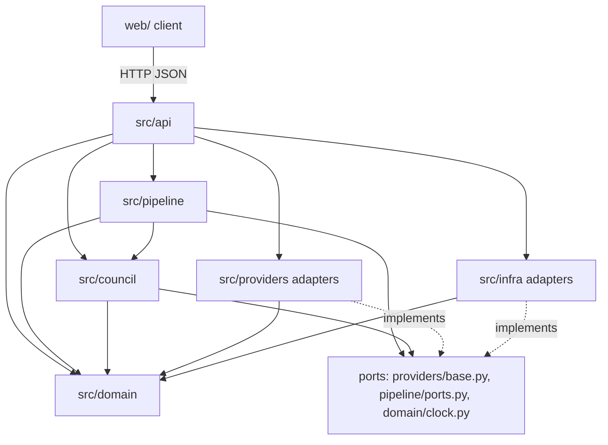
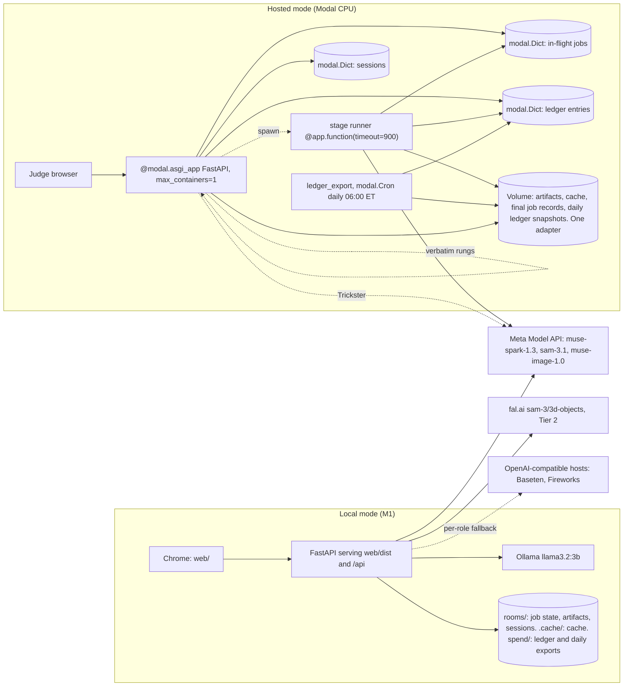
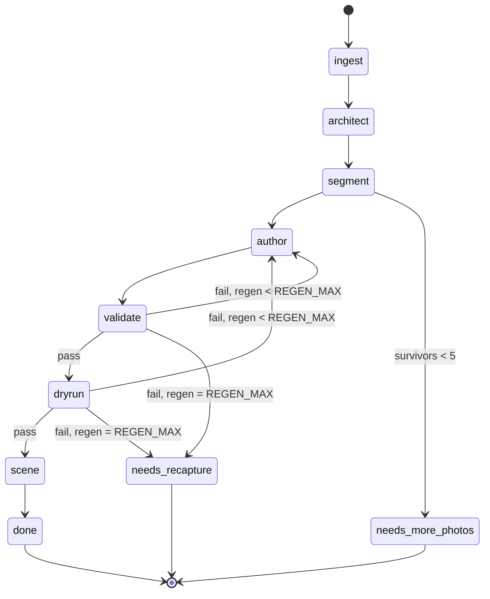
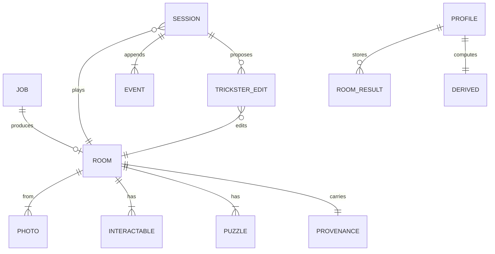

# Architecture Spine — Keyframe

## Design Paradigm

Hexagonal core: `src/domain` is pure (no network, filesystem, or clock); `src/council` and `src/pipeline` depend only on the domain and on ports; adapters in `src/providers` and `src/infra` implement ports and never import each other; `src/api` wires and depends inward only. The build is a pipes-and-filters job over persisted stages; play is an event-sourced session whose state is replayed from an append-only log. The client (`web/`) renders state and posts events.



## Invariants & Rules

### AD-1 — Pure domain, inward dependencies

- **Binds:** all
- **Prevents:** vendor calls and I/O leaking into puzzle, session, and rung logic
- **Rule:** `src/domain` imports nothing outside the standard library and pydantic; `src/council` and `src/pipeline` import only `src/domain` and port modules; adapters import only ports and the domain; no module outside `src/providers`, `src/infra` and `src/api` imports an adapter. `Clock` is a Protocol in `src/domain/clock.py` (re-exported by `pipeline/ports.py`); its session and build implementations live in `src/infra/clocks.py`. `tests/test_boundaries.py` walks every module's imports and fails on a violation, in the offline suite.

### AD-2 — One data shape

- **Binds:** CAP-1 to CAP-6, CAP-11
- **Prevents:** two shapes of Room, Interactable, Puzzle, or TricksterEdit
- **Rule:** Schema v1 (`schema-v1.md`) is realized once as pydantic models in `src/domain/schema.py`; the same JSON shapes travel the HTTP API, the job artifacts, and the client, with `PlayView` as the client shape (AD-3); `GET /schema` returns every model the API accepts or returns (`Room`, `RoomDraft`, `PlayView`, `BuildView`, `RoomView`, `Derived`, `RoomResult`, `Meta`, the event models, the error envelope); `web/` types are generated from it and committed, never hand-written, with a test that fails when stale; polymorphic fields (`Puzzle.solution` by `lock_type`, `TricksterEdit.payload` by `type`) are tagged unions (separate pydantic models with a `Literal` discriminator, emitted as `oneOf`) so generated TypeScript is a discriminated union; JSON keys are snake_case end to end.

### AD-3 — Solution boundary

- **Binds:** CAP-2, CAP-3, CAP-4, CAP-5, CAP-6, CAP-13
- **Prevents:** a solution reaching Spark, Ollama, or a browser
- **Rule:** `Room` carries solutions and leaves the server only through the full-Room download `GET /builds/<job_id>/room`; `src/domain/redact.py` exposes `to_prompt_view(room) -> RoomView` and `to_play_view(room) -> PlayView`; `RoomView` is the only type a prompt builder accepts and `src/council` functions are typed on it; play routes return only `PlayView` (drops `solution` and `provenance`, keeps `evidence`); generated `web/types` contain `PlayView`, never `Room`. `to_build_view(room, job) -> BuildView` is the third projection (PRD FR-38): mask polygons per photo, the puzzle graph (`id`, `lock_type`, `requires`, `is_exit`), per-rule validator verdicts, dry-run pass or fail per puzzle, the regeneration count, and the model table from provenance; it never carries `solution`, dry-run answers, or a clue-to-answer pairing; `GET /builds/<job_id>/view` serves it in both modes without the access code. `derived` is consumed only by `domain/rungs.py` and the `HintPhraser` port; `RoomView` and the Trickster game-state summary carry no profile field. Validator and dry-run reasons are structured `{rule, puzzle_id, field}` plus a fixed message per rule and never quote an offending token or an answer; the regeneration prompt carries the reason list only, never the previous draft; the rejected card renders the fixed message. Tests: a fixture test renders every council prompt from a Room with sentinel solutions and asserts none appears (the code string, the order id list in sequence, the use_on pair, the find target id, any `derived` key, any reason text); a second asserts `HintPhraser` input is exactly `(rung_text, derived)`; an API fixture test asserts no `solution` key in any play or `BuildView` response. Validator rule 5 stays a check on rungs and clue inside `validate`.

### AD-4 — Server-authoritative, event-sourced session

- **Binds:** CAP-3, CAP-4, CAP-5, CAP-8, CAP-12
- **Prevents:** client and server disagreeing on what is open; the browser clock driving the nudge
- **Rule:** a session is an append-only event log; event payloads are pydantic models in `schema.py`: client-posted `ClickEvent(interactable_id)`, `LockInputEvent(puzzle_id, input: CodeInput | UseOnInput)`, `HintRequestEvent(puzzle_id)`; server-appended `IdleTickEvent()`, `TricksterCardEvent(edit_id, accepted, reason, room_revision)`, `RungChangeEvent(puzzle_id, rung, triggered_by: [event ids])`. Every event carries `t_ms` (session-clock ms since start) stamped by the API at append; a client timestamp is rejected (422). The client posts a `click` for every hotspot click and `lock_input` only for `code` (submit) and `use_on` (drop); `find` is a click equal to the solution of an available find puzzle; `order` is judged per click against the trailing click buffer when it reaches solution length (a mismatch is one wrong attempt and resets the buffer); a wrong attempt is counted only on a failed `code` or `use_on` input or a failed completed `order` buffer, never on a click. `idle_tick` is appended by the API on each `GET /sessions/<id>` read when at least 5000 ms have passed since the last event (no background ticker; the client polls every 2000 ms); idle seconds are computed in `apply` from `t_ms` of the last non-tick event. `SessionStateMachine.apply` is the sole writer of `locks_open`, `inventory`, `current_rung: dict[puzzle_id, 0..3]`, `wrong_attempts[puzzle_id]`, `rungs_used`, the order buffer, `rung_changes[]`, `trickster_window`, and `trickster_calls`; `select_rung(events, derived, thresholds)` in `domain/rungs.py` is pure and evaluated inside `apply`, appending a `rung_change` so replay equals live; the active puzzle for idle and hint events is the puzzle of the most recent `lock_input` or attempted click. Player text, typed or transcribed, is reduced client-side to a `hint_request` and never travels as text; a `hint_request` returns the current rung, or a fixed no-hint line when none is open. `apply` opens `trickster_window` only when a lock has just opened and the previous window closed at least 3 minutes ago on the session clock; it counts proposal calls and refuses the seventh; the API never calls the Trickster outside an open window; a `SpendCapExceeded` or `ProviderError` during a window closes it and is recorded as a `trickster_card {accepted: false, edit_id: null, reason: provider_unavailable}` rendered as a skipped card. State is replayed from events; the client renders state and posts events, never infers lock state.

### AD-5 — Model ports, and a Guide port no cloud adapter may implement

- **Binds:** CAP-1, CAP-2, CAP-4, CAP-5, CAP-6, CAP-7, CAP-11, CAP-12
- **Prevents:** scattered API calls; a hosted Guide; profile data in a cloud prompt
- **Rule:** `ModelProvider` is the only way to reach a model; ports are synchronous and the stage runner fans out through a bounded thread pool (segment: one call per label, at most 12 concurrent), so the mock stays trivial. Signatures: `chat(messages, *, images=[], response_schema=None, reasoning_effort='low', model=None) -> ChatResponse` (extends the scaffold's `chat`, drops `max_tokens` and `temperature`); `segment(label, image) -> list[Polygon] | None`; `reconstruct3d(image, mask) -> GlbRef`; `generate_image(prompt) -> ImageResponse`; `transcribe(wav) -> str`. `response_schema` is passed with `strict: false` (Meta default) or through one `strict_schema(model)` helper in `src/domain/schema.py` that inlines `$defs`, sets `additionalProperties: false` and fills `required`; Schema v1 contains no self-referencing model; `reasoning_effort` is one of `minimal|low|medium|high|xhigh`, never `none` (HTTP 400), and the mock refuses `none` too. Adapters are `mock`, `meta` (Chat Completions for the council, Responses for `sam-3.1`; standard tier only, never contributor), `openai_compatible` (`base_url`: Baseten, Fireworks), `fal`, `ollama`; `wiring.py` resolves one `ModelProvider` per council role (`architect`, `riddler`, `dryrun`, `trickster`, `image`) from `Settings`; the Riddler and Trickster fallbacks replace a role's provider, never the global one. `HintPhraser` is a separate port implemented only by the Ollama adapter and a verbatim adapter, selected by `GUIDE` alone: `phrase(rung_text, derived) -> str` and `greet(derived) -> str` use a fixed prefix, stay under 400 tokens, time out at 5 s, after which the verbatim adapter answers (the rung text; a template filled with the numbers) and the event log records `phraser_fallback`; neither receives room content; the room-2 greeting is `council/greeting.py` over `greet` and names no object or solution. Council and pipeline receive ports by injection.

### AD-6 — Guarded calls

- **Binds:** CAP-1, CAP-2, CAP-5, CAP-7, CAP-9, CAP-12
- **Prevents:** uncounted spend; re-billed photos; a regeneration served its own failed answer
- **Rule:** every hosted adapter call runs `Cache.get_or_call(key)` then, on a miss only, `SpendLedger.guard(kind, estimate)` inside `src/providers`; a hit is never priced or refused; the mock provider bypasses both. `key = sha256(model id || schema hash || full prompt including the system message || reasoning_effort || sha256 of each image in order || attempt)`; text-only calls omit the image segment; `attempt` defaults to 0, `regenerate.py` passes the regeneration count on every Riddler and dry-run call and `trickster.py` passes the window index. `CACHE=off` bypasses the cache, never the ledger. `domain/ledger.py` is pure arithmetic (estimate, settle, would-exceed); `providers/spend.py` is `SpendLedger`, one per process, serializing `guard` under a lock: it appends a `reserved` entry with the estimate through the `LedgerStore` port and replaces it with observed cost from returned usage after the call; one entry per priced call keyed by a `call_` ULID, a retried call (AD-13) being one entry; the per-kind estimate is read from the store and seeded from `budgets.md` plus `reconstruct3d` $0.02. `providers/cache.py` is key logic over the `Cache` port. `scripts/ledger.py reset|export` is the only way to reset the counter (Nov 5) and the source of the spend export.

### AD-7 — Build as a persisted job

- **Binds:** CAP-1, CAP-2, CAP-10
- **Prevents:** in-memory job state; the 150 s web timeout killing a build; two byte streams for one photo
- **Rule:** the client produces the downscaled JPEG (Canvas, EXIF orientation applied, long edge 1280, quality 0.85) and uploads it with the original in one multipart `POST /builds`; ingest stores both byte for byte and re-encodes neither, rejects fewer than 6 or more than 10 photos, accepts JPEG only (HEIC, PNG and every other format raise `UnsupportedImage`), and rejects (422) a downscaled file whose long edge is not 1280 or whose orientation tag is not 1; `photos[i].hash` is sha256 of the stored downscaled bytes and every model call, cache key and mask uses those bytes; the README and the capture screen state the input requirement as "6 to 10 JPEG photos". Stages `ingest → architect → segment → author → validate → dryrun → scene` run in order through `JobRunner.start(job_id)` and persist job state plus stage artifacts through `JobStore` and `ArtifactStore` after each stage with timings; every stage rereads job state from `JobStore` on entry so a restarted runner resumes at the last persisted stage; no request blocks on a stage; `GET /builds/<job_id>` reads persisted state only. Segment issues one `segment` call per label concurrently (at most 12); mask selection (IoU, plural grouping, the 1% and 12 caps) is `domain/masks.py`, pure, called by segment; segment ends the job with status `needs_more_photos` when fewer than 5 interactables survive and no authoring call is made. The author stage persists a `RoomDraft` (Riddler raw output, kept for provenance and the regeneration count); the job's `room` artifact, the only key play routes read, is written once `validate` and (unless `DRY_RUN=off`) the dry run pass. Hosted: the stage runner is a separate `@app.function(timeout=900)` invoked with `.spawn()` and is the one writer per job; the ASGI function keeps its default timeout and never owns a build; `ArtifactStore.put` ends with `Volume.commit()` and every read begins with `Volume.reload()` from a container holding no open Volume files; the `modal.Dict` holds in-flight job state only (entries expire after 7 idle days); on scene the final job record is written to the Volume beside the Room and `GET /builds` falls through Dict then Volume; a job whose runner dies is marked `failed` with its stage by a watchdog read of the `FunctionCall` id stored in the job record. The local `ArtifactStore` writes under `rooms/` only.

### AD-8 — The browser owns the profile

- **Binds:** CAP-4, CAP-6, CAP-13
- **Prevents:** profile data landing on the hosted server or the Volume
- **Rule:** the client is the system of record for the player profile and per-room results (IndexedDB under `PROFILE`; a JSON file under cut 2); `Derived` and `RoomResult` are pydantic models in `schema.py`: `Derived = {sessions >= 0, persistence in [-1, 1], time_to_first_hint_s: float | null, mean_rung_per_lock_type: dict[LockType, float in [0, 3]]}` with pydantic bounds (422 outside) and `Derived.fresh()` when no profile exists; the nudge threshold is `clamp(90000 * (1 + 0.5 * persistence), 60000, 135000)` ms in `domain/rungs.py`, its only reader. A session start (`POST /sessions {room_id, derived}`) carries only the `derived` block, and in hosted mode the client always sends `Derived.fresh()`, so no profile number reaches the hosted server and hosted rooms show the first-room welcome, never a greeting; the server computes `RoomResult` from the log at `GET /sessions/<id>/result` with `demo: DEMO_TIMESCALE > 1`, and the client excludes demo results when recomputing `Derived`; `web/profile` is the only writer and keys `RoomResult` by `room_id` inside the profile it owns (no `profile_name` on `Room`). The hosted server never persists `derived` or profile data and never joins its transient session log to a profile; under cut 2 only, the local-mode server exposes `GET|PUT /profile/<name>` writing `rooms/profiles/<name>.json` on the player's machine, a route absent in hosted mode. Retention: hosted session logs are deleted 24 h after their last event or when their room is deleted; judge rooms, originals, sessions and cache entries are deleted together by `scripts/purge_judge_rooms.py` (Tue Nov 10); demo rooms persist; local `rooms/` and `.cache/` are never deleted by the app; the retention text served by `GET /meta` is one string in `src/api/meta.py` quoting the Meta and fal retention summaries from the pre-Oct 26 verification; a test asserts `.gitignore` contains `rooms/`, `photos/`, `captures/`, `uploads/`, `*.heic`, `.cache/`.

### AD-9 — One codebase, two modes

- **Binds:** CAP-10 and every capability it hosts
- **Prevents:** a forked hosted code path; two origins; an unbounded judge quota
- **Rule:** `MODE=local|hosted` selects adapters only (`JobStore`, `ArtifactStore`, `JobRunner`, `SessionStore`, `LedgerStore`, `Cache`) in `src/infra`; `GUIDE` is the only selector of `HintPhraser`; no mode branch exists outside `src/infra` and `src/api` wiring; the HTTP surface (Conventions) is identical in both modes. `JobRunner`: local, an in-process task; hosted, `modal.Function.spawn` of the stage runner (AD-7). `SessionStore` (`append`, `read_all`, `list_ids`, `delete`): local, JSON under `rooms/sessions/`; hosted, `modal.Dict`; no session state in a process variable. `LedgerStore` (`append`, `entries`), append-only: local, `spend/ledger.jsonl` under a file lock (git-ignored, outside `.cache/` so clearing the cache never touches it); hosted, one `modal.Dict` key per entry summed on read. A daily export is the durable record of spend against the credit: hosted, a scheduled function in `modal_app.py`, `@app.function(schedule=modal.Cron("0 6 * * *", timezone="America/New_York"))`, writes every Dict entry to the Volume as `spend/hosted-<date>.jsonl` each day (Dict entries expire after 7 idle days); locally, `scripts/ledger.py export` merges the local entries and the latest hosted snapshot into `spend/exports/ledger-<date>.json` (committed), runs at API startup and after every completed build, and the export is committed with each day's work from Mon Oct 26; `scripts/ledger.py reset` refuses to run unless today's export exists. `Cache` (`get`, `put`): local, `.cache/`; hosted, the Volume through the same adapter as artifacts. FastAPI mounts `web/dist` at `/` in both modes (one origin, no CORS); API routes live under `/api/`; in development the Vite server proxies `/api/*` to FastAPI. Hosted mode guards `POST /builds` and `GET /builds/<job_id>/room` with `X-Access-Code`, every other route is open; the hosted `JobStore` keeps a build counter and refuses the 21st build with `build_quota_exceeded`; demo rooms are seeded onto the Volume by `scripts/seed_rooms.py` under `rooms/demo/`, judge rooms land under `rooms/judge/`, and `scripts/purge_judge_rooms.py` deletes only the latter; `modal_app.py` sets `max_containers=1` (raising it is Deferred).

### AD-10 — Two clocks

- **Binds:** CAP-1, CAP-4, CAP-5, CAP-8
- **Prevents:** the demo timescale touching the capture proof or the event timeline
- **Rule:** a `Clock` port supplies all time; the session clock (`infra/clocks.py`) applies `DEMO_TIMESCALE` only to the thresholds wiring passes into `apply` (nudge threshold, rung spacing, Trickster window), never to `t_ms` or the poll cadence, and the client never reads it for timing; the build clock never applies it and stamps stage timings and the capture timer.

### AD-11 — Scene contract

- **Binds:** CAP-1, CAP-3, CAP-11
- **Prevents:** a second scene model for Tier 2; hotspots in the wrong pixel space
- **Rule:** Tier 1 scenes are Three.js textured planes with polygon hotspots in the scene graph Tier 2 reuses; hotspot id equals interactable id; a hotspot is the union of the interactable's `polygons[]` (one per instance) in the pixel space of the stored downscaled JPEG, rendered from `GET /rooms/<room_id>/photos/<i>`, never an in-memory canvas; when SAM yields nothing the segment stage writes the box rectangle scaled to the same space as the single polygon, so the client never reads `box` and never branches on the source; the client sends interactable ids and lock inputs, never puzzle logic; the DOM-only fallback keeps the same hotspot id contract. Accessibility floor (PRD NFR-14): every hotspot is focusable with Tab and shows a visible focus ring, Enter acts as a click, a "Show all objects" toggle outlines every hotspot, a `use_on` input can be given by select-then-click and posts the same `UseOnInput` as a drop, and rungs, cards and the greeting are announced through one polite live region.

### AD-12 — Validation is the write gate; rooms are immutable, edits are session-scoped

- **Binds:** CAP-2, CAP-5, CAP-10
- **Prevents:** an unvalidated room reaching a player; a Trickster edit mutating a room shared across sessions
- **Rule:** `validate(room)` and `check_dry_run(room, answers) -> DryRunResult` in `domain/validator.py` are pure; `council/dryrun.py` `build_dry_run_prompt(room_view, response_schema)` is pure over `RoomView`; the pipeline dryrun stage makes the model call (reasoning low) and is the only place answers meet solutions; `DryRunAnswers` is a pydantic model keyed by puzzle id reusing the solution union; the dry run runs unless `DRY_RUN=off`. The job's `room` artifact is written only after `validate` passes (AD-7) and the build's Room is immutable thereafter. `domain/edits.py` exposes pure `validate_edit(room, state, edit)` (per-type payload constraints: a decoy never on the exit puzzle, the rung and edge exist; the window and between-puzzles bounds) and `apply_edit(room, edit) -> Room`; a proposal is accepted only if `validate_edit` passes and `validate(apply_edit(room, edit))` passes rules 1 to 8 (no dry run); the result is appended to the session log as a `trickster_card` with `accepted` and a reason code, never an in-place mutation; the session's effective Room is `apply_edit` folded over accepted edits at replay, `room_revision` is the count of accepted edits, and `GET /sessions/<id>/room` serves its `PlayView`, which the client refetches when `room_revision` changes; `loosen` is applied by `SessionStateMachine.apply` to `current_rung`; the rejected card renders the fixed message against the unchanged room. Edits never reach `ArtifactStore`.

### AD-13 — Typed errors; one retry loop

- **Binds:** CAP-1, CAP-2, CAP-5, CAP-9, CAP-10
- **Prevents:** nested retries; silent provider failure; a mid-game error halting play
- **Rule:** stages raise `ProviderError`, `ValidationError`, `DryRunError`, `TooFewInteractables`, `UnsupportedImage`, `BuildQuotaExceeded`, or `SpendCapExceeded`; the regeneration loop (at most `REGEN_MAX`, default 2, then status `needs_recapture`) lives in `src/pipeline/regenerate.py`, the sole writer of the regeneration count, which the stage runner reads into provenance; adapters retry once with backoff on 429 and 5xx only; the API error envelope is `{error: {code, message, stage}}` with `stage: null` outside the pipeline and is used by build and session-creation routes only; the UI asks for more photos on `too_few_interactables` and for re-capture on `regen_exhausted`; inside play, Trickster errors become a skipped card (AD-4), never an envelope.

### AD-14 — Configuration enters once [ADOPTED]

- **Binds:** all
- **Prevents:** drift in how flags are read; a copied `.env` hosting the Guide
- **Rule:** environment only, read once by `Settings` (`src/config.py`) and injected; no module reads `os.environ` directly. Product flags: `MODE`, `CACHE`, `SPEND_CAP_USD`, `DEMO_TIMESCALE`, `DEMO_TRICKSTER`, `MIN_CONTAINERS`, `GUIDE=ollama|verbatim` (default `ollama` under `MODE=local`, `verbatim` under `MODE=hosted`; `Settings` fails at startup on `MODE=hosted` with `GUIDE=ollama`), `DRY_RUN=on|off`, `REGEN_MAX` (default 2). Adapter settings: `MODEL_PROVIDER` as the default for `PROVIDER_<ROLE>` (`ARCHITECT`, `RIDDLER`, `DRYRUN`, `TRICKSTER`, `IMAGE`; default `meta`) with per-role model ids (`CHAT_MODEL` and `IMAGE_MODEL` retire), `META_MODEL_API_KEY`, `META_MODEL_API_BASE_URL`, `OPENAI_COMPATIBLE_BASE_URL`, `OPENAI_COMPATIBLE_API_KEY`, `FAL_KEY`, `OLLAMA_HOST`, `ACCESS_CODE`. Secrets are environment variables: locally from `.env` (git-ignored; `.env.example` committed with every key blank), hosted from one `modal.Secret` named `keyframe` attached to the app and the runner function; a test asserts `.env` is ignored and `.env.example` lists every key `Settings` reads. The client reads `PROFILE` from the `?profile=` query parameter, default `dev`, and `GET /meta` echoes it.

### AD-15 — Demo mode swaps the source, never the check

- **Binds:** CAP-5, CAP-8
- **Prevents:** a faked reject
- **Rule:** `DEMO_TRICKSTER=scripted` replaces only the proposal source (a recorded proposals artifact); the validator and card rendering are unchanged; cut 1 is realized through the same scripted source with pre-authored proposals and no live Spark path, and the validator still runs on every card. `GET /meta` returns the `Meta` model with exactly `{mode, guide, trickster: live | scripted | cut1, demo_timescale, cache, profile, disclosure, retention}` for the UI and README.

### AD-16 — Provenance travels with the room

- **Binds:** CAP-1, CAP-9
- **Prevents:** unexplainable rooms in the submission
- **Rule:** the pipeline writes `provenance` (model ids, prompt hashes, stage timings, regeneration count, spend per stage from the ledger) into every Room; spend per stage and applied edit ids are part of the schema's provenance (approved Oct 21); the spend log export is derived from the ledger, never hand-kept.

### AD-17 — One owner per package; offline tests per story

- **Binds:** all
- **Prevents:** merge conflicts between parallel agents; network-dependent tests
- **Rule:** one owner per top-level package (`domain`, `council`, `pipeline`, `providers`, `api`, `infra`, `web`); a story touches one package plus tests, or first declares the port change it needs; `pytest` runs offline against the mock provider for every story; adapter tests use recorded fixtures under `tests/fixtures`; a story is done only when `pytest` passes offline.

### AD-18 — Interactable identity and image space

- **Binds:** CAP-1, CAP-2, CAP-3
- **Prevents:** puzzles referencing ids no interactable has; hotspots rendered off the texture
- **Rule:** `ix_` ids are minted only by the pipeline segment stage after mask selection and the 12 cap, never taken from a model response; the Architect response is a separate `ArchitectResponse` model in `src/domain/schema.py` correlated by list position; the Riddler's response schema uses ordinal keys (`p1`..`p6`) for puzzles and their `requires` references, mapped by the author stage to `pz_` ULIDs before `validate`; interactable references in model output use the `ix_` ids given in the prompt view and are parsed back by exact id match, never by label; `box` is converted to pixels at segment time; `box` and `polygons` are in the pixel space of the stored downscaled JPEG; `tier2` is the only field referencing original pixels; `Interactable.photo` indexes `photos[]` in upload order.

## Consistency Conventions

| Concern | Convention |
| --- | --- |
| Naming | snake_case JSON keys everywhere, including TypeScript; Python modules and functions snake_case; pydantic models PascalCase; ports end in `Port`-free nouns (`ModelProvider`, `HintPhraser`, `JobStore`, `ArtifactStore`, `JobRunner`, `SessionStore`, `LedgerStore`, `Cache`, `Clock`) |
| Ids | prefixed ULIDs: `room_`, `job_`, `sess_`, `pz_`, `ix_`, `te_`, `call_`; ids are assigned only by server code (AD-18); interactable id is the hotspot id |
| HTTP surface | all routes under `/api/` (written without the prefix elsewhere): `POST /builds`, `GET /builds/<job_id>`, `GET /builds/<job_id>/room` (full Room), `GET /builds/<job_id>/view` (BuildView), `GET /rooms/<room_id>` (PlayView), `GET /rooms/<room_id>/photos/<i>`, `POST /sessions {room_id, derived}`, `GET /sessions/<id>`, `GET /sessions/<id>/room`, `POST /sessions/<id>/events`, `POST /sessions/<id>/trickster`, `GET /sessions/<id>/result`, `GET /schema`, `GET /meta`; local cut 2 only: `GET\|PUT /profile/<name>` |
| Job status | `queued`, `running` (with `stage`), `done`, `failed`, `needs_more_photos`, `needs_recapture` |
| Prompt view | `to_prompt_view` keeps per interactable `id`, `label`, `attributes`, `instances`, `photo` and per puzzle `id`, `lock_type`, `requires`, `is_exit`, `clue`, `lore`, `rungs`; drops `solution`, `evidence`, `provenance`, `photos[].hash` and paths, `box`, `polygons`, `tier2`, `validator_result`; each builder renders a subset (dry run: labels, clues, rungs; Trickster: plus the game-state summary; Riddler: interactables only); photos reach prompts as bytes through the adapter |
| Hotspot geometry | pixel coordinates of the stored downscaled 1280 px JPEG; Spark boxes (0 to 1000 grid) are converted to frame pixels and clamped at ingest; SAM boxes arrive in source pixels; SAM mask rasters (H, W smaller than the frame) are scaled to the frame; the hotspot polygon is `meta-sam-parser`'s SVG path (M/L/Z) parsed to `[[x, y], ...]` in frame pixels and simplified in `domain/masks.py`; `polygons: polygon[] \| null`, one per instance |
| Validator tokens | rule 5 matches code strings and digits as exact whole tokens regardless of length; the three-character floor applies to label words only; exactly one `is_exit` puzzle is rule 7's first check and `validate` reads `is_exit` only |
| Time and formats | ISO 8601 UTC; session clock in milliseconds (`t_ms`); images stored as the client-produced downscaled 1280 px JPEG plus the original (AD-7) |
| Errors | `{error: {code, message, stage}}`; codes are the typed error class names in snake_case |
| Logging | one JSON line per event with `job_id` or `session_id`, stage, duration_ms, and spend_usd where a call was made |
| State mutation | domain functions return new values; `SessionStateMachine.apply` and the pipeline stage runner are the only writers; Trickster edits live in the session log (AD-12) |
| Config and auth | env via `Settings` only; hosted access code as the `X-Access-Code` header on the routes AD-9 names; no accounts |
| Code style | Python 3.13 type hints, pydantic v2, ruff defaults; TypeScript strict; tests under `tests/<package>/` mirroring `src/`; the first providers story bumps `requires-python` to `>=3.13`, moves the Stack table into `[project.dependencies]` with `==` pins, drops `requirements.txt`, and sets the Meta `DEFAULT_BASE_URL` to `https://api.meta.ai/v1` |

## Stack

| Name | Version |
| --- | --- |
| Python | 3.13 |
| FastAPI | 0.156.4 |
| uvicorn | 0.54.0 |
| pydantic | 2.14.1 |
| httpx | 0.28.1 |
| Pillow | 13.0.0 |
| meta-sam-parser | 0.1.0 |
| fal-client | 1.0.3 |
| ollama (Python client) | 0.6.3 |
| Ollama runtime, `llama3.2:3b` | v0.40.6 |
| modal | 1.6.2 |
| pytest | 9.1.1 |
| python-dotenv | 1.2.4 |
| Node | 24.22 (LTS; `.nvmrc` = 24, `engines.node` = "24.x") |
| Vite | 8.3.4 |
| three | 0.186.1 |
| TypeScript | ~6.0.3 (Vite 8 vanilla-ts template default) |
| json-schema-to-typescript | 16.0.0 |
| @sparkjsdev/spark (Tier 3 only) | 2.4.0 |

## Structural Seed

```text
src/
  domain/      schema.py (RoomDraft, Room, RoomView, PlayView, ArchitectResponse, DryRunAnswers, Derived, RoomResult, Meta, events, strict_schema), validator.py, redact.py, edits.py, masks.py, session.py, rungs.py, ledger.py, clock.py (Clock Protocol)
  council/     architect.py, riddler.py, dryrun.py, trickster.py, greeting.py   # prompt builders over RoomView; greeting over derived only
  pipeline/    build.py (stage runner), ports.py (JobStore, ArtifactStore, JobRunner, SessionStore, LedgerStore, Cache; re-exports Clock), regenerate.py
  providers/   base.py (ModelProvider, HintPhraser), mock.py, meta_api.py, openai_compatible.py, fal.py, ollama.py, cache.py (key logic), spend.py (SpendLedger)
  api/         app.py (routes, mounts web/dist), wiring.py (Settings → adapters, one provider per role), meta.py (Meta, retention text), modal_app.py (hosted entry, max_containers=1)
  infra/       local.py (JSON JobStore, disk ArtifactStore under rooms/, in-process JobRunner, JSON SessionStore, jsonl LedgerStore, disk Cache), modal.py (Dict JobStore, Volume ArtifactStore and Cache, spawn JobRunner, Dict SessionStore, Dict LedgerStore), clocks.py (session and build clocks)
  config.py    Settings (existing)
scripts/       portraits.py (generate_image once), seed_rooms.py, purge_judge_rooms.py, ledger.py (reset|export)
web/           Vite + TypeScript + three: scene/, api/, profile/ (IndexedDB), wizards/, types/ (generated), public/portraits/ (committed)
tests/         test_boundaries.py, domain/, council/, pipeline/, providers/, api/, fixtures/
rooms/, photos/, captures/, uploads/, *.heic, .cache/   git-ignored inputs and cache (asserted by a test)
spend/         ledger.jsonl (git-ignored live ledger), exports/ledger-<date>.json (committed daily)
.env (ignored), .env.example (committed)
```







`PROFILE`, `ROOM_RESULT`, and `DERIVED` live only in the client; `SESSION`, `EVENT` and `TRICKSTER_EDIT` are server-side and transient (`SessionStore`); `TRICKSTER_EDIT.accepted` means `validator_result.ok` and applied.

## Capability → Architecture Map

| Capability / Area | Lives in | Governed by |
| --- | --- | --- |
| CAP-1 capture to interactables | `pipeline` stages ingest, architect, segment; `domain/masks.py`; `providers/meta_api.py`; `meta-sam-parser` | AD-5, AD-6, AD-7, AD-10, AD-13, AD-16, AD-18 |
| CAP-2 authoring, validator, dry run | `council/riddler.py`, `council/dryrun.py`, `domain/validator.py`, `pipeline/regenerate.py` | AD-2, AD-3, AD-12, AD-13, AD-18 |
| CAP-3 play | `domain/session.py`, `domain/redact.py` (PlayView), `web/scene`, `api` session routes | AD-3, AD-4, AD-11, AD-18 |
| CAP-4 Guide hint ladder | `domain/rungs.py`, `providers/ollama.py`, `HintPhraser` | AD-3, AD-4, AD-5, AD-8, AD-10 |
| CAP-5 Trickster | `council/trickster.py`, `domain/edits.py`, `domain/validator.py`, `SessionStore`; Fireworks fallback model id confirmed on Oct 26 before a fixture is recorded | AD-3, AD-4, AD-6, AD-12, AD-13, AD-15 |
| CAP-6 player memory | `web/profile`, session start payload, `council/greeting.py`, local cut-2 `GET\|PUT /profile/<name>` | AD-3, AD-5, AD-8 |
| CAP-7 wizard art | `scripts/portraits.py` calls `generate_image` once; outputs committed under `web/public/portraits/`; play never calls `generate_image` | AD-6 |
| CAP-8 demo mode | `infra/clocks.py`, `council/trickster.py` scripted source, `GET /meta` | AD-10, AD-15 |
| CAP-9 spend and cache | `providers/spend.py`, `providers/cache.py`, `domain/ledger.py`, `LedgerStore`, `Cache`, `scripts/ledger.py` | AD-6, AD-9, AD-13, AD-16 |
| CAP-10 hosted URL (Tier 1.5) | `api/modal_app.py`, `infra/modal.py`, `scripts/seed_rooms.py`, `scripts/purge_judge_rooms.py` | AD-7, AD-9, AD-12, AD-13 |
| CAP-11 Tier 2 room | `web/scene` (same graph), `providers/fal.py` | AD-11, Deferred |
| CAP-12 voice | `providers` `transcribe`, browser recognition fallback; reduced to `hint_request` | AD-4, AD-5, Deferred |
| CAP-14 Build view | `domain/redact.py` (`to_build_view`), `api` build routes, `web` build view | AD-3, AD-16 |
| CAP-13 privacy | `web/profile`, `.gitignore` (tested), `GET /meta` retention text, `meta` adapter standard tier only | AD-3, AD-5, AD-8, AD-14 |

## Deferred

- Thu Oct 22 schema review is one pick: the decoy storage shape (three options with tradeoffs in `schema-v1.md`). The reviewers' other schema changes (`polygons`, `is_exit` only, no `profile_name`, rule 5 token matching, the API models, provenance fields) were approved Oct 21 and are applied in `schema-v1.md`; the schema freezes Mon Oct 26.
- Tier 2 object placement when fal's per-object translation, rotation and scale metadata does not compose into a room layout (hand-placed transforms in `tier2` versus a layout stage): decided by the pre-Oct 26 spike, inside the Tier 2 epic.
- Clue cards (Tier 1.5) as an optional post-scene stage.
- Tier 3 splat integration (`@sparkjsdev/spark` in the same scene graph): never gating.
- Voice transport (REST file upload versus browser recognition) and its UI.
- TypeScript type generation tool (`json-schema-to-typescript` or quicktype): the first `web/` story picks; the invariant in AD-2 holds either way; `json-schema-to-typescript` 16 has no `typescript` dependency, so the TypeScript major is independent of it.
- Raising `max_containers` above 1 on the hosted app, pending an atomic ledger store.
- The delivery plan's cut-1 line "the reject is not evaluated live" is superseded by AD-15 (scripted source, live validator).
- Authentication beyond the access code; observability beyond JSON logs; a database; CI beyond `pytest`, `test_boundaries.py` and the type-staleness test; mobile layout; multi-user.
