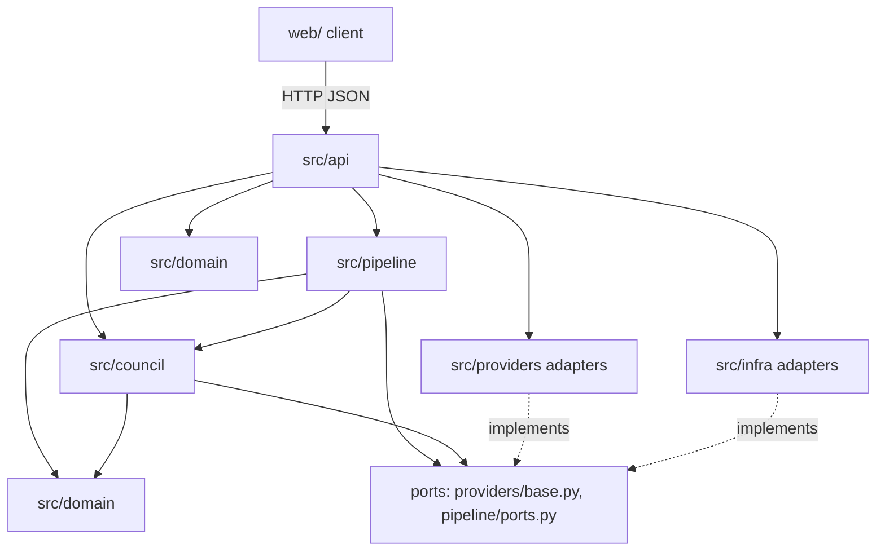
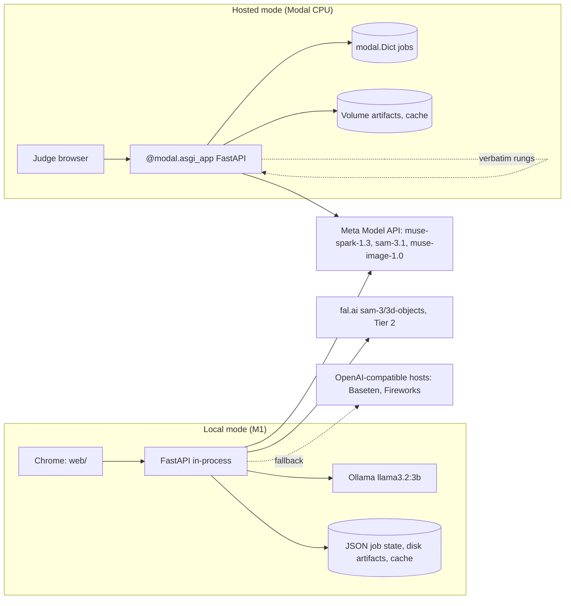
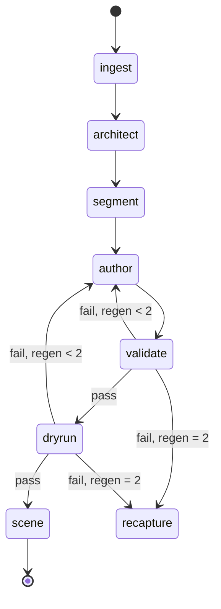
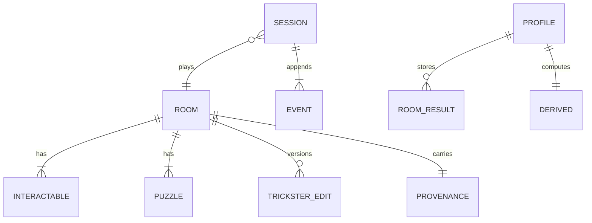

# Architecture Spine — Keyframe

## Design Paradigm

Hexagonal core: `src/domain` is pure (no network, filesystem, or clock); `src/council` and `src/pipeline` depend only on the domain and on ports; adapters in `src/providers` and `src/infra` implement ports and never import each other; `src/api` wires and depends inward only. The build is a pipes-and-filters job over persisted stages; play is an event-sourced session whose state is replayed from an append-only log. The client (`web/`) renders state and posts events.



## Invariants & Rules

### AD-1 — Pure domain, inward dependencies

- **Binds:** all
- **Prevents:** vendor calls and I/O leaking into puzzle, session, and rung logic
- **Rule:** `src/domain` imports nothing outside the standard library and pydantic; `src/council` and `src/pipeline` import only `src/domain` and port modules; adapters import only ports and the domain; no module outside `src/providers` and `src/api` imports an adapter.

### AD-2 — One data shape

- **Binds:** CAP-1 to CAP-6, CAP-11
- **Prevents:** two shapes of Room, Interactable, Puzzle, or TricksterEdit
- **Rule:** Schema v1 (`schema-v1.md`) is realized once as pydantic models in `src/domain/schema.py`; the same JSON travels the HTTP API, the job artifacts, and the client; `web/` types are generated from `GET /schema` and committed, never hand-written, with a test that fails when stale; JSON keys are snake_case end to end.

### AD-3 — Solution boundary

- **Binds:** CAP-2, CAP-4, CAP-5
- **Prevents:** a solution reaching Spark or Ollama
- **Rule:** `Room` carries solutions; `RoomView` (`src/domain/redact.py`) is the only type a prompt builder accepts, produced by one `redact` function that drops `solution`, lock targets, and validator-only fields; `src/council` functions are typed on `RoomView`; the test suite runs validator rule 5 over every rendered prompt fixture.

### AD-4 — Server-authoritative, event-sourced session

- **Binds:** CAP-3, CAP-4, CAP-5, CAP-8
- **Prevents:** client and server disagreeing on what is open
- **Rule:** a session is an append-only event log (`click`, `lock_input`, `idle_tick`, `hint_request`, `trickster_card`); `SessionStateMachine.apply` is the sole writer of `locks_open`, `inventory`, `current_rung`, and `trickster_window`; state is replayed from events; the client renders state and posts events, never infers lock state.

### AD-5 — Model ports, and a Guide port no cloud adapter may implement

- **Binds:** CAP-1, CAP-2, CAP-4, CAP-5, CAP-7, CAP-11, CAP-12
- **Prevents:** scattered API calls; a hosted Guide
- **Rule:** `ModelProvider` (`chat` with images, `response_schema`, `reasoning_effort`; `segment`; `reconstruct3d`; `generate_image`; `transcribe`) is the only way to reach a model; `HintPhraser` is a separate port implemented only by the Ollama adapter and a verbatim adapter; adapters are `mock`, `meta` (Chat Completions for the council, Responses for `sam-3.1`), `openai_compatible` (`base_url`: Baseten, Fireworks), `fal`, `ollama`; council and pipeline receive ports by injection.

### AD-6 — Guarded calls

- **Binds:** CAP-1, CAP-2, CAP-5, CAP-7, CAP-9, CAP-12
- **Prevents:** uncounted spend; re-billed photos
- **Rule:** every hosted adapter call passes `SpendLedger.guard(kind, estimate)` then `Cache.get_or_call(key)` inside `src/providers`; `key = sha256(downscaled image bytes) + prompt + model id + schema hash`; `CACHE=off` bypasses the cache, never the ledger; the ledger counter persists through `JobStore`.

### AD-7 — Build as a persisted job

- **Binds:** CAP-1, CAP-2, CAP-10
- **Prevents:** in-memory job state; the 150 s web timeout killing a build
- **Rule:** `POST /builds` stores photos and returns a job id; stages `ingest → architect → segment → author → validate → dryrun → scene` run in order and persist job state plus stage artifacts through `JobStore` and `ArtifactStore` after each stage with timings; no request blocks on a stage; `GET /builds/<job id>` reads persisted state only.

### AD-8 — The browser owns the profile

- **Binds:** CAP-4, CAP-6, CAP-13
- **Prevents:** profile data landing on the server or the Volume
- **Rule:** the client is the system of record for the player profile and per-room results (IndexedDB under `PROFILE`; a JSON file under cut 2); a session start carries only the `derived` block; the server never persists `derived` or profile data and never joins its transient session log to a profile; hosted sessions and their artifacts are deleted as a unit.

### AD-9 — One codebase, two modes

- **Binds:** CAP-10 and every capability it hosts
- **Prevents:** a forked hosted code path
- **Rule:** `MODE=local|hosted` selects adapters only (`JobStore`, `ArtifactStore`, `HintPhraser`, ledger persistence) in `src/infra`; no mode branch exists outside `src/infra` and `src/api` wiring; the HTTP API is identical in both modes.

### AD-10 — Two clocks

- **Binds:** CAP-1, CAP-4, CAP-5, CAP-8
- **Prevents:** the demo timescale touching the capture proof
- **Rule:** a `Clock` port supplies all time; the session clock applies `DEMO_TIMESCALE` to the nudge threshold, rung spacing, and Trickster window; the build clock never applies it and stamps stage timings and the capture timer.

### AD-11 — Scene contract

- **Binds:** CAP-3, CAP-11
- **Prevents:** a second scene model for Tier 2
- **Rule:** Tier 1 scenes are Three.js textured planes with polygon hotspots in the scene graph Tier 2 reuses; hotspot id equals interactable id; the client sends interactable ids and lock inputs, never puzzle logic; the DOM-only fallback keeps the same hotspot id contract.

### AD-12 — Validation is the write gate; rooms are immutable versions

- **Binds:** CAP-2, CAP-5
- **Prevents:** an unvalidated room reaching a player
- **Rule:** `validate(room)` and `dry_run(room_view)` are pure functions; a Room is written to `ArtifactStore` only after `validate` passes (and `dry_run`, unless cut 4); a `TricksterEdit` produces a new Room version written only if `validate` passes, never an in-place mutation; the rejected card references the unchanged version.

### AD-13 — Typed errors; one retry loop

- **Binds:** CAP-1, CAP-2, CAP-9
- **Prevents:** nested retries; silent provider failure
- **Rule:** stages raise `ProviderError`, `ValidationError`, `DryRunError`, or `SpendCapExceeded`; the regeneration loop (at most 2, then re-capture) lives in `src/pipeline`, never in adapters; adapters retry once with backoff on 429 and 5xx only; the API error envelope is `{error: {code, message, stage}}`.

### AD-14 — Configuration enters once [ADOPTED]

- **Binds:** all
- **Prevents:** drift in how flags are read
- **Rule:** environment only, read once by `Settings` (`src/config.py`) and injected; flags `MODE`, `CACHE`, `SPEND_CAP_USD`, `DEMO_TIMESCALE`, `DEMO_TRICKSTER`, `MIN_CONTAINERS`, `GUIDE=ollama|verbatim`, and client-side `PROFILE`; no module reads `os.environ` directly.

### AD-15 — Demo mode swaps the source, never the check

- **Binds:** CAP-5, CAP-8
- **Prevents:** a faked reject
- **Rule:** `DEMO_TRICKSTER=scripted` replaces only the proposal source (a recorded proposals artifact); the validator and card rendering are unchanged; `GET /meta` exposes the active mode, flags, and disclosure text for the UI and README.

### AD-16 — Provenance travels with the room

- **Binds:** CAP-1, CAP-9
- **Prevents:** unexplainable rooms in the submission
- **Rule:** the pipeline writes `provenance` (model ids, prompt hashes, stage timings, regeneration count, spend per stage) into every Room; the spend log export is derived from the ledger, never hand-kept.

### AD-17 — One owner per package; offline tests per story

- **Binds:** all
- **Prevents:** merge conflicts between parallel agents; network-dependent tests
- **Rule:** one owner per top-level package (`domain`, `council`, `pipeline`, `providers`, `api`, `infra`, `web`); a story touches one package plus tests, or first declares the port change it needs; `pytest` runs offline against the mock provider for every story; adapter tests use recorded fixtures under `tests/fixtures`; a story is done only when `pytest` passes offline.

## Consistency Conventions

| Concern | Convention |
| --- | --- |
| Naming | snake_case JSON keys everywhere, including TypeScript; Python modules and functions snake_case; pydantic models PascalCase; ports end in `Port`-free nouns (`ModelProvider`, `JobStore`, `ArtifactStore`, `HintPhraser`, `Clock`) |
| Ids | prefixed ULIDs: `room_`, `job_`, `sess_`, `pz_`, `ix_`, `te_`; interactable id is the hotspot id |
| Time and formats | ISO 8601 UTC; session clock in milliseconds; images stored as the downscaled 1280 px JPEG plus the original; masks as polygons in image pixel space |
| Errors | `{error: {code, message, stage}}`; codes are the typed error class names in snake_case |
| Logging | one JSON line per event with `job_id` or `session_id`, stage, duration_ms, and spend_usd where a call was made |
| State mutation | domain functions return new values; `SessionStateMachine.apply` and the pipeline stage runner are the only writers |
| Config and auth | env via `Settings` only; hosted access code as the `X-Access-Code` header; no accounts |
| Code style | Python 3.13 type hints, pydantic v2, ruff defaults; TypeScript strict; tests next to the package they cover under `tests/` |

## Stack

| Name | Version |
| --- | --- |
| Python | 3.13 |
| FastAPI | 0.156.4 |
| uvicorn | 0.54.0 |
| pydantic | 2.14.1 |
| httpx | 0.28.1 |
| Pillow | 13.0.0 |
| meta-sam-parser | 0.1.0 |
| fal-client | 1.0.3 |
| ollama (Python client) | 0.6.3 |
| Ollama runtime, `llama3.2:3b` | v0.40.6 |
| modal | 1.6.2 |
| pytest | 9.1.1 |
| python-dotenv | 1.x |
| Node | 24 LTS |
| Vite | 8.3.4 |
| three | 0.186.1 |
| TypeScript | 7.0.2 |
| json-schema-to-typescript | 16.0.0 |
| @sparkjsdev/spark (Tier 3 only) | 2.4.0 |

## Structural Seed

```text
src/
  domain/      schema.py, validator.py, redact.py, session.py, rungs.py, ledger.py, clock.py
  council/     architect.py, riddler.py, dryrun.py, trickster.py   # prompt builders over RoomView
  pipeline/    build.py (stage runner), ports.py (JobStore, ArtifactStore, Clock), regenerate.py
  providers/   base.py (ModelProvider, HintPhraser), mock.py, meta_api.py, openai_compatible.py, fal.py, ollama.py, cache.py, spend.py
  api/         app.py (routes), wiring.py (Settings → adapters), modal_app.py (hosted entry)
  infra/       local.py (JSON JobStore, disk ArtifactStore), modal.py (Dict JobStore, Volume ArtifactStore)
  config.py    Settings (existing)
web/           Vite + TypeScript + three: scene/, api/, profile/ (IndexedDB), wizards/, types/ (generated)
tests/         domain/, council/, pipeline/, providers/, api/, fixtures/
rooms/, .cache/   git-ignored inputs and cache
```







`PROFILE`, `ROOM_RESULT`, and `DERIVED` live only in the client; `SESSION` and `EVENT` are server-side and transient.

## Capability → Architecture Map

| Capability / Area | Lives in | Governed by |
| --- | --- | --- |
| CAP-1 capture to interactables | `pipeline` stages ingest, architect, segment; `providers/meta_api.py` | AD-5, AD-6, AD-7, AD-10, AD-16 |
| CAP-2 authoring, validator, dry run | `council/riddler.py`, `council/dryrun.py`, `domain/validator.py` | AD-2, AD-3, AD-12, AD-13 |
| CAP-3 play | `domain/session.py`, `web/scene`, `api` session routes | AD-4, AD-11 |
| CAP-4 Guide hint ladder | `domain/rungs.py`, `providers/ollama.py`, `HintPhraser` | AD-3, AD-5, AD-8, AD-10 |
| CAP-5 Trickster | `council/trickster.py`, `domain/validator.py` | AD-3, AD-12, AD-15 |
| CAP-6 player memory | `web/profile`, session start payload | AD-8 |
| CAP-7 wizard art | `providers/meta_api.py` `generate_image`, cache | AD-6 |
| CAP-8 demo mode | `domain/clock.py`, `council/trickster.py` scripted source, `GET /meta` | AD-10, AD-15 |
| CAP-9 spend and cache | `providers/spend.py`, `providers/cache.py`, `domain/ledger.py` | AD-6, AD-16 |
| CAP-10 hosted URL | `api/modal_app.py`, `infra/modal.py` | AD-7, AD-9 |
| CAP-11 Tier 2 room | `web/scene` (same graph), `providers/fal.py` | AD-11, Deferred |
| CAP-12 voice | `providers` `transcribe`, browser recognition fallback | AD-5, Deferred |
| CAP-13 privacy | `web/profile`, `.gitignore`, `GET /meta` retention text | AD-8, AD-14 |

## Deferred

- Tier 2 object placement when fal returns no pose (hand-placed transforms in `tier2` versus a layout stage): decided by the pre-Oct 26 spike, inside the Tier 2 epic.
- Tier 3 splat integration (`@sparkjsdev/spark` in the same scene graph): never gating.
- Voice transport (REST file upload versus browser recognition) and its UI.
- TypeScript type generation tool (`json-schema-to-typescript` or quicktype): the first `web/` story picks; the invariant in AD-2 holds either way.
- Authentication beyond the access code; observability beyond JSON logs; a database; CI beyond `pytest` and the type-staleness test; mobile layout; multi-user.
