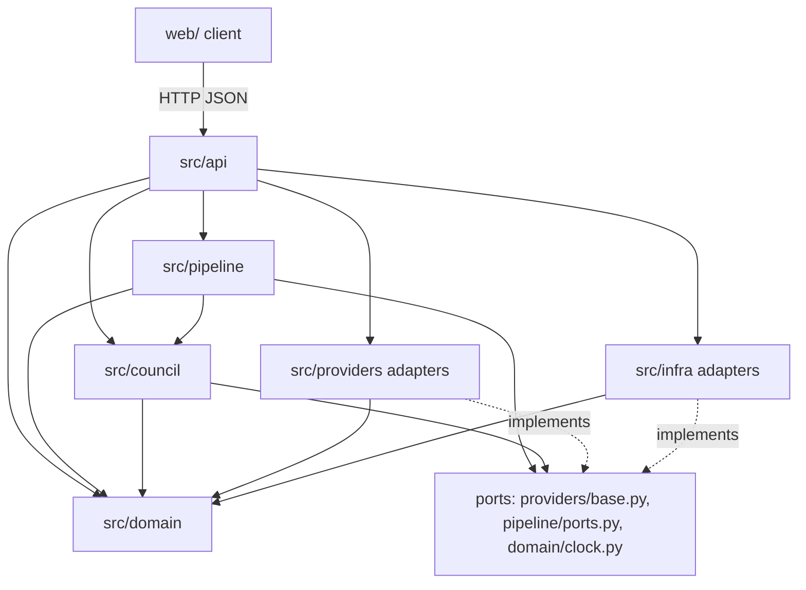
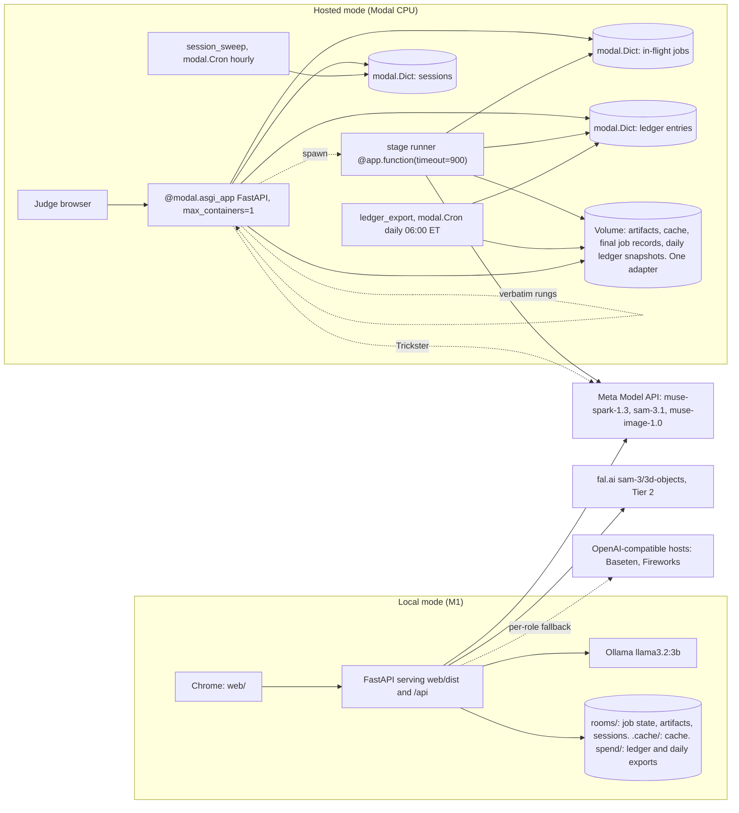
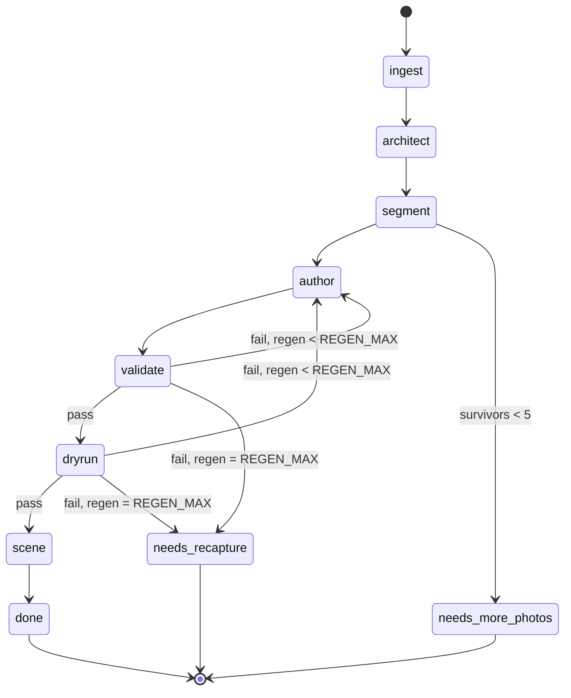
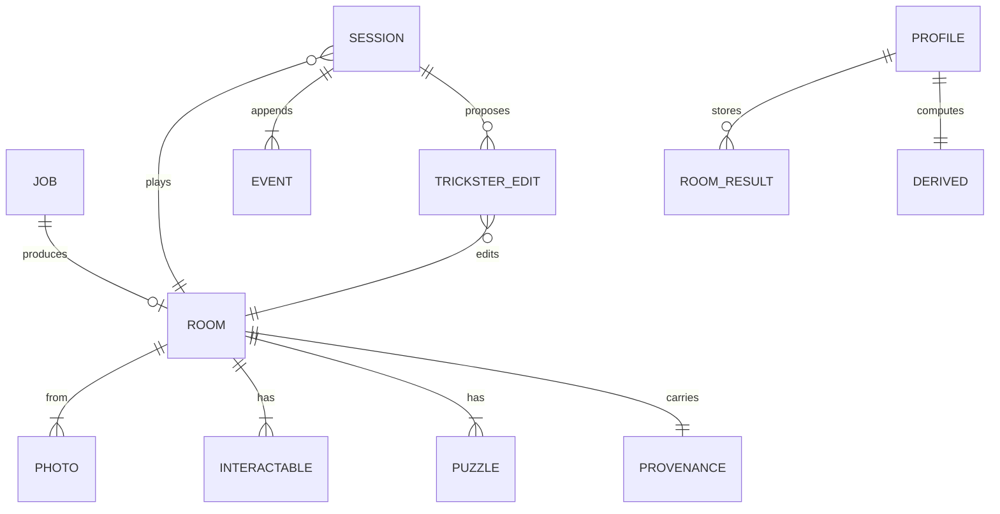

# Architecture Spine — Keyframe

## Design Paradigm

Hexagonal core: `src/domain` is pure (no network, filesystem, or clock); `src/council` and `src/pipeline` depend only on the domain and on ports; adapters in `src/providers` and `src/infra` implement ports and never import each other; `src/api` wires and depends inward only. The build is a pipes-and-filters job over persisted stages; play is an event-sourced session whose state is replayed from an append-only log. The client (`web/`) renders state and posts events.



## Invariants & Rules

### AD-1 — Pure domain, inward dependencies

- **Binds:** all
- **Prevents:** vendor calls and I/O leaking into puzzle, session, and rung logic
- **Rule:** `src/domain` imports nothing outside the standard library and pydantic; `src/council` and `src/pipeline` import only `src/domain` and port modules; adapters import only ports and the domain; no module outside `src/providers`, `src/infra` and `src/api` imports an adapter. `Clock` is a Protocol in `src/domain/clock.py` (re-exported by `pipeline/ports.py`); its session and build implementations live in `src/infra/clocks.py`. `tests/test_boundaries.py` walks every module's imports and fails on a violation, in the offline suite.

### AD-2 — One data shape

- **Binds:** CAP-1 to CAP-6, CAP-11
- **Prevents:** two shapes of Room, Interactable, Puzzle, or TricksterEdit
- **Rule:** Schema v1 (`schema-v1.md`) is realized once as pydantic models in `src/domain/schema.py`; the same JSON shapes travel the HTTP API, the job artifacts, and the client, with `PlayView` as the client shape (AD-3); `GET /schema` returns every model the API accepts or returns (`Room`, `RoomDraft`, `PlayView`, `BuildView`, `RoomView`, `RoomSummary`, `AccessCheck`, `Derived`, `RoomResult`, `Meta`, `TricksterCard`, the job state, the session state, the event models, the error envelope); `Room.name` is optional (string, at most 40 characters), set only when a Demo room is seeded and absent on ordinary Builds, where the UI falls back to the build time; `Room.decoys[]` (`{id, puzzle, interactable, visible_attribute}`, option A of the Oct 22 review) is empty on the stored build Room and written only by `apply_edit` into the session's effective Room (AD-12); `web/` types are generated from it and committed, never hand-written, with a test that fails when stale; polymorphic fields (`Puzzle.solution` by `lock_type`, `TricksterEdit.payload` by `type`) are tagged unions (separate pydantic models with a `Literal` discriminator, emitted as `oneOf`) so generated TypeScript is a discriminated union, and a response schema containing one is sent with `strict: false` on the Meta path; no model-response schema (`RoomDraft`, `DryRunAnswers`, `ArchitectResponse`) has a map-typed field (lists or fixed keys such as `p1`..`p6` instead), so the Baseten strict-mode fallback can express it; JSON keys are snake_case end to end.

### AD-3 — Solution boundary

- **Binds:** CAP-2, CAP-3, CAP-4, CAP-5, CAP-6, CAP-13
- **Prevents:** a solution reaching Spark, Ollama, or a browser; a Trickster edit payload reaching a browser
- **Rule:** `Room` carries solutions and leaves the server only through the full-Room download `GET /builds/<job_id>/room`; `src/domain/redact.py` exposes `to_prompt_view(room) -> RoomView` and `to_play_view(room) -> PlayView`; `RoomView` is the only type a prompt builder accepts and `src/council` functions are typed on it; play routes return only `PlayView` (drops `solution`, `provenance` and `decoys`; `to_play_view` merges each puzzle's real `evidence` and its `Room.decoys[]` entries into one unflagged `evidence_cards` list in a stable order seeded by the room id, so `PlayView` never marks which card is false); generated `web/types` contain `PlayView`, never `Room`. `to_build_view(room, job) -> BuildView` is the third projection (PRD FR-38): per photo the mask polygons with each interactable's label, the puzzle graph (`id`, `lock_type`, `requires`, `is_exit`), per-rule validator verdicts, dry-run pass, fail or `skipped` per puzzle (`skipped` under `DRY_RUN=off`, cut 4; PRD FR-38 wins over SPEC CAP-14 "absent"), the regeneration count and the configured `REGEN_MAX` (1 under cut 7), the build time, the model table from provenance and the job's call rows (role, model id, host where it ran, cached or billed per call; AD-16), and the Room's disclosure list (AD-15); it never carries `solution`, dry-run answers, or a clue-to-answer pairing; `GET /builds/<job_id>/view` serves it in both modes without the access code; for a job that is not `done` (`queued`, `running`, `failed`, `needs_more_photos`, `needs_recapture`) it answers 409 `build_not_ready` with the job `status` in the envelope (AD-13), and the Build view's not-ready state keys on it. `to_card_view(event) -> TricksterCard` is the fourth projection (Oct 22): `edit_id`, `accepted`, `edit_type` (`decoy`, `merge`, `loosen` or `shortcut`; null on a skipped card), `puzzle_id`, `related_puzzle_id` (the second puzzle of a `merge` or `shortcut`, else null), `room_revision`, `reason` (null on an accepted card, `provider_unavailable` on a skipped card, the failing rule number on a rejected card) and `message` (the Validator's fixed message on a rejected card, else null), plus the event's `t_ms` for the Card log's session time; it never carries the payload, `interactable`, `visible_attribute`, `rung` or any content field. Session state, as returned by `GET /sessions/<id>` and by the replies to `POST /sessions/<id>/events` and `POST /sessions/<id>/trickster`, carries `cards: list[TricksterCard]` in session order and never `TricksterCardEvent`, `TricksterEdit` or the raw event log; the stored `TricksterCardEvent` keeps the full `TricksterEdit` for the AD-12 fold, server-side only; the client builds the Card log from `cards`. Mask preview: once the segment stage completes, `GET /builds/<job_id>` carries per interactable `id`, `label`, `photo` index and `polygons`, solution-free, before the `room` artifact exists (AD-7). `derived` is consumed only by `domain/rungs.py` and the `HintPhraser` port; `RoomView` and the Trickster game-state summary carry no profile field. Validator and dry-run reasons are structured `{rule, puzzle_id, field}` plus a fixed message per rule and never quote an offending token or an answer; the regeneration prompt carries the reason list only, never the previous draft; the rejected card renders the fixed message. Tests: a fixture test renders every council prompt from a Room with sentinel solutions and asserts none appears (the code string, the order id list in sequence, the use_on pair, the find target id, any `derived` key, any reason text); a second asserts `HintPhraser` input is exactly `(rung_text, derived)`; an API fixture test asserts no `solution` key in any play, job-state or `BuildView` response, and serializes `GET /sessions/<id>` and the replies to `POST /sessions/<id>/events` and `POST /sessions/<id>/trickster` after an accepted decoy and a rejected proposal whose payload carries a sentinel token, asserting that neither the decoy's interactable or attribute nor the token appears anywhere in the JSON; a decoy test asserts that real and decoy `evidence_cards` in `PlayView` cannot be told apart (no flag, key, `te_` id or ordering rule). Validator rule 5 stays a check inside `validate` and covers rungs, `clue` and `evidence.visible_attribute` with the same token matching (Conventions): every displayed attribute says where to look and never holds a solution token.

### AD-4 — Server-authoritative, event-sourced session

- **Binds:** CAP-3, CAP-4, CAP-5, CAP-6, CAP-8, CAP-12
- **Prevents:** client and server disagreeing on what is open; the browser clock driving the nudge; exploring clicks counted as wrong attempts; the client guessing a puzzle it cannot see; an edit payload in session state; two source calls or two cards for one Trickster window
- **Rule:** a session is an append-only event log; event payloads are pydantic models in `schema.py`: client-posted `ClickEvent(interactable_id)`, `LockInputEvent(input: CodeInput(puzzle_id, code) | UseOnInput(item, target) | OrderStartInput(puzzle_id) | OrderStopInput(puzzle_id))`, `HintRequestEvent(puzzle_id | null)`; server-appended `IdleTickEvent()`, `OpeningLineEvent(kind: greeting | welcome, text)`, `TricksterCardEvent(edit_id, edit: TricksterEdit | null, accepted, reason, room_revision)` (stored server-side only, the full edit kept for the AD-12 fold; session state carries its `TricksterCard` projection, AD-3), `RungChangeEvent(puzzle_id, rung, triggered_by: [event ids])`. Every event carries `t_ms` (session-clock ms since start) stamped by the API at append; a client timestamp is rejected (422). The client posts a `click` for every hotspot click, with one exception: the target click of a select-then-click (keyboard, and the alternative to drag) posts only the `use_on` lock input, never a click, exactly like a drop. `lock_input` is posted only for `code` (submit), `use_on` (drop or select-then-click), and the order start and stop given from the order puzzle's entry in the Wizard notes. `use_on` carries no `puzzle_id`: the server resolves the puzzle from the `(item, target)` pair among available `use_on` puzzles (by `item`, else by `target`); a pair resolving to none is logged and counts nothing. `find` is a click equal to the solution of an available find puzzle. `order` (PRD FR-12 aligned to this rule Oct 21): the buffer is armed only by an `order_start` naming an available order puzzle; `order_start` is a lock input, so it makes its puzzle the Active puzzle and arms the buffer, and the buffer is armed only while its puzzle is the Active puzzle: whenever the Active puzzle changes to a different puzzle (a lock input on another puzzle, a `hint_request` naming another available puzzle, a Merge hiding the armed puzzle, or the armed puzzle opening), `apply` disarms and clears the buffer with no wrong attempt in the same step that recomputes `active_puzzle_id` (the armed puzzle and the buffer are state only `apply` writes), the UI resets the pips, and the player re-arms with "Start the sequence"; while armed, every hotspot click fills the buffer whichever object it hits, so progress reveals nothing about which objects belong; at solution length a match opens the lock and disarms, a mismatch is one wrong attempt on the armed puzzle, which is the Active puzzle, and clears the buffer, which stays armed; `order_stop` disarms and clears with no wrong attempt; clicks while unarmed are exploration and never fill the buffer or count. A wrong attempt is counted only on a failed `code` input, a resolved `use_on` pair that does not match, or a mismatched full-length armed order buffer, never on a click. `idle_tick` is appended by the API on each `GET /sessions/<id>` read when at least 5000 ms have passed since the last event (no background ticker; the client polls every 2000 ms); idle seconds are computed in `apply` from `t_ms` of the last non-tick event. `SessionStateMachine.apply` is the sole writer of `locks_open`, `inventory`, `current_rung: dict[puzzle_id, 0..3]`, `wrong_attempts[puzzle_id]`, `rungs_used`, the order buffer and its armed puzzle, `active_puzzle_id`, `opening_line`, `phrasing`, `rung_changes[]`, `trickster_window`, `trickster_calls`, and `cards` (the `TricksterCard` projection of every `trickster_card`, in session order; AD-3); `select_rung(events, derived, thresholds)` in `domain/rungs.py` is pure and evaluated inside `apply`, appending a `rung_change` so replay equals live. Session state exposes `active_puzzle_id`, the Active puzzle for idle and hint events: it is recomputed in `apply` after every event and is the most recently targeted available unsolved puzzle, where a target is set by a `lock_input` (`code`, `order_start`, `order_stop`, or a `use_on` the server resolved) or by a `hint_request` that names an available unsolved puzzle; when no target has been set, or the targeted puzzle has opened or become unavailable (a Merge hiding it), it is the earliest available unsolved puzzle in `Room.puzzles[]` order; it is null only when no puzzle is available (the Exit has opened); clicks never set a target, because a click cannot be attributed to a puzzle, so an exploration click (one that opens nothing) leaves it unchanged; after a click that opens a `find` puzzle the Active puzzle is recomputed like after any event, so the click that opens the Active `find` puzzle moves it to the next available unsolved puzzle. A `hint_request` may omit `puzzle_id` and the server resolves it to the Active puzzle; the client always omits it. A `hint_request` naming a puzzle that is not available or is already open is answered for the current Active puzzle, which does not move; the event is still appended and counts for the Active puzzle in the session's records (an Early ask when it has no rung open); a `puzzle_id` that is not in the Room is a malformed body and answers 422 with nothing appended; once `active_puzzle_id` is null (the Exit has opened) a `hint_request` returns the no-hint line and is logged against no puzzle. Idle-triggered and wrong-attempt rungs apply to the Active puzzle, and every wrong attempt is made on the Active puzzle: `code` and `use_on` inputs target their puzzle, and the armed order buffer belongs to the Active puzzle (the order rule), so the puzzle a wrong attempt is counted on is the puzzle the rung goes to. Tests: a fresh session targets the earliest available puzzle; after a `code` puzzle opens, the Active puzzle moves to the next available unsolved one (a `find` puzzle included) with no further input; when the Active puzzle is a `find` puzzle, the click that opens it moves `active_puzzle_id` to the next available unsolved puzzle; a Merge that hides the Active puzzle moves it; a hint request naming an available puzzle moves it; an order buffer armed on A is disarmed with no wrong attempt by a wrong code on B, which becomes the Active puzzle, and A's clicks are exploration until A is re-armed. Session state carries `opening_line {kind, text}` and `phrasing`: `phrasing` is true from session start until the `opening_line` event is appended, which happens at once for a welcome and in hosted mode (hosted never phrases), and in local mode after the Guide model phrases a greeting or its 5 s fallback answers (AD-5). Player text, typed or transcribed, is reduced client-side to a `hint_request` and never travels as text; a `hint_request` returns the current rung, or a fixed no-hint line when none is open. `apply` opens `trickster_window` only when a lock has just opened and the previous window closed at least 3 minutes ago on the session clock; it counts proposal calls and refuses the seventh; the API never calls the Trickster outside an open window. The API serializes event appends per session: one lock per session id in the process (local, in-process; hosted, inside the single container, `max_containers=1`, AD-9). `POST /sessions/<id>/trickster` takes the session lock, reads the window, marks the window `pending` in the state it serves while the source runs (a mark held with the lock, never an event, so replay is unchanged), and releases the lock only after the card is appended; a request that arrives while `pending`, or outside an open window, answers 200 with the unchanged session state, appending no event, sending no error envelope and making no source call; a window therefore yields at most one source call and one card. Test: two concurrent requests give one source invocation, one card and `trickster_calls` + 1. A `SpendCapExceeded` or `ProviderError` during a window closes it and is recorded as a `trickster_card {accepted: false, edit_id: null, reason: provider_unavailable}` rendered as a skipped card. State is replayed from events; the client renders state and posts events, never infers lock state.

### AD-5 — Model ports, and a Guide port no cloud adapter may implement

- **Binds:** CAP-1, CAP-2, CAP-4, CAP-5, CAP-6, CAP-7, CAP-11, CAP-12
- **Prevents:** scattered API calls; a hosted Guide; profile data in a cloud prompt
- **Rule:** `ModelProvider` is the only way to reach a model; ports are synchronous and the stage runner fans out through a bounded thread pool (segment: one call per label, at most 12 concurrent), so the mock stays trivial. Signatures: `chat(messages, *, images=[], response_schema=None, reasoning_effort='low', model=None) -> ChatResponse` (extends the scaffold's `chat`, drops `max_tokens` and `temperature`); `segment(label, image) -> list[Polygon] | None`; `reconstruct3d(image, mask: Mask3D) -> GlbRef`, where `Mask3D {label, polygons (frame pixels), frame_size}` is defined in `src/domain/schema.py` and the fal prompt is its `label`; `generate_image(prompt) -> ImageResponse`; `transcribe(wav) -> str`. `response_schema` is passed with `strict: false` (Meta default) or through one `strict_schema(model)` helper in `src/domain/schema.py` that inlines `$defs`, sets `additionalProperties: false` and fills `required`; Schema v1 contains no self-referencing model; `reasoning_effort` is one of `minimal|low|medium|high|xhigh`, never `none` (HTTP 400), and the mock refuses `none` too. Adapters are `mock`, `meta` (Chat Completions for the council, Responses for `sam-3.1`; standard tier only, never contributor), `openai_compatible` (`base_url`: Baseten, Fireworks), `fal`, `ollama`; `wiring.py` resolves one `ModelProvider` per council role (`architect`, `riddler`, `dryrun`, `trickster`, `image`) from `Settings`; the Riddler and Trickster fallbacks replace a role's provider, never the global one. `HintPhraser` is a separate port implemented only by the Ollama adapter and a verbatim adapter, selected by `GUIDE` alone: `phrase(rung_text, derived) -> str` and `greet(derived) -> str` use a fixed prefix, stay under 400 tokens, time out at 5 s, after which the verbatim adapter answers (the rung text; a template filled with the numbers) and the event log records `phraser_fallback`; neither receives room content. The opening line (AD-4) is the First-room welcome, a fixed line, when `derived.sessions == 0` and always in hosted mode; otherwise it is the greeting, `council/greeting.py` over `greet`, naming no object or solution, whose verbatim form is the fixed Greeting template filled from `derived`; `POST /sessions` returns it as `opening_line {kind: greeting | welcome, text}` with `phrasing`, `text` being null while `phrasing` is true. Prompts carry the voice rules: the Riddler author prompt (`council/riddler.py`) carries the generated-line rules (Clue and Lore in the Riddler voice, Rungs in the Guide voice on the scaffold ladder, no solution tokens); the `phrase` and `greet` fixed prefixes carry reword, never add content, and the Greeting brief. Council and pipeline receive ports by injection.

### AD-6 — Guarded calls

- **Binds:** CAP-1, CAP-2, CAP-5, CAP-7, CAP-9, CAP-12
- **Prevents:** uncounted spend; re-billed photos; a regeneration served its own failed answer; one mode spending the other's allocation
- **Rule:** every hosted adapter call runs `Cache.get_or_call(key)` then, on a miss only, `SpendLedger.guard(kind, estimate)` inside `src/providers`; a hit is never priced or refused; the mock provider bypasses both. `key = sha256(model id || schema hash || full prompt including the system message || reasoning_effort || sha256 of each image in order || attempt)`; text-only calls omit the image segment; `attempt` defaults to 0, `regenerate.py` passes the regeneration count on every Riddler and dry-run call and `trickster.py` passes the window index. `CACHE=off` bypasses the cache, never the ledger. `domain/ledger.py` is pure arithmetic (estimate, settle, would-exceed); `providers/spend.py` is `SpendLedger`, one per process, serializing `guard` under a lock; `guard` and the running total sum only the entries of the current epoch (the date of the last `scripts/ledger.py reset`, carried on every entry, AD-9), so spend before the Nov 5 reset counts against neither cap; hosted, the web container and each runner container hold their own lock over the shared `keyframe-ledger` Dict, so concurrent containers can overshoot the cap by the estimates of calls in flight, accepted for the hackathon (an atomic ledger store is Deferred); it appends a `reserved` entry with the estimate through the `LedgerStore` port and replaces it with observed cost from returned usage after the call; one entry per priced call keyed by a `call_` ULID, a retried call (AD-13) being one entry; the per-kind estimate is read from the store and seeded from `budgets.md` plus `reconstruct3d` $0.02. `SPEND_CAP_USD` stays a per-store, per-call ceiling, with per-mode defaults that sum to the credit allowance: local 60 and hosted 20 through Wed Nov 4 (80 in all), local 5 and hosted 20 from Thu Nov 5 (25 in all); `Settings` reads the override per mode (AD-14; the Modal Secret `keyframe` carries the hosted value); the daily export prints the local total, the hosted total and their sum against the combined ceiling, and moving dollars between the two allocations is a `Settings` change made only after an export shows the room for it. Test: a local total at its allocation refuses locally while hosted still accepts, and the export's sum line matches. `providers/cache.py` is key logic over the `Cache` port. `scripts/ledger.py reset|export` is the only way to reset the counter (Nov 5, by starting a new epoch in both stores, AD-9) and the source of the spend export.

### AD-7 — Build as a persisted job

- **Binds:** CAP-1, CAP-2, CAP-10
- **Prevents:** in-memory job state; the 150 s web timeout killing a build; two byte streams for one photo
- **Rule:** the client produces the downscaled JPEG (Canvas, EXIF orientation applied, long edge 1280, quality 0.85) and uploads it with the original in one multipart `POST /builds`; ingest stores both byte for byte and re-encodes neither, refuses fewer than 6 or more than 10 photos with 422 `photo_count`, accepts JPEG only (HEIC, PNG and every other format raise `UnsupportedImage`, keeping its code `unsupported_image`), and refuses a downscaled file whose long edge is not 1280 or whose orientation tag is not 1 with 422 `bad_downscale`, each in the AD-13 error envelope; `photos[i].hash` is sha256 of the stored downscaled bytes and every model call, cache key and mask uses those bytes; the README and the capture screen state the input requirement as "6 to 10 JPEG photos". Stages `ingest → architect → segment → author → validate → dryrun → scene` run in order through `JobRunner.start(job_id)` and persist job state plus stage artifacts through `JobStore` and `ArtifactStore` after each stage with timings; every stage rereads job state from `JobStore` on entry so a restarted runner resumes at the last persisted stage; no request blocks on a stage; `GET /builds/<job_id>` reads persisted state only. Segment issues one `segment` call per label concurrently (at most 12); mask selection (IoU, plural grouping, the 1% and 12 caps) is `domain/masks.py`, pure, called by segment; segment ends the job with status `needs_more_photos` when fewer than 5 interactables survive and no authoring call is made; otherwise it persists the survivors' `id`, `label`, `photo` and `polygons` into job state as the mask preview (AD-3), which carries no puzzle or solution field. The author stage persists a `RoomDraft` (Riddler raw output, kept for provenance and the regeneration count); the job's `room` artifact, the only key play routes read, is written once `validate` and (unless `DRY_RUN=off`) the dry run pass. Hosted: the stage runner is a separate `@app.function(timeout=900)` invoked with `.spawn()` and is the one writer per job; the ASGI function keeps its default timeout and never owns a build; `ArtifactStore.put` ends with `Volume.commit()` and every read begins with `Volume.reload()` from a container holding no open Volume files; the `modal.Dict` holds in-flight job state only (entries expire after 7 idle days); on scene the final job record is written to the Volume beside the Room and `GET /builds` falls through Dict then Volume; the runner owns the job record, and the web function never writes it back; the `FunctionCall` id is stored under its own Dict key `call:<job_id>`; a watchdog reading that id marks a job whose runner dies `failed` with its stage, backstopped by `ORPHAN_S` (60 s: a queued job whose spawn was never recorded is orphaned) and `DEADLINE_S` (1,200 s: the runner timeout plus margin, past which a job whose poll stays unknown counts as dead); `GET /builds/<job_id>` answers 202 while `queued` or `running` and 200 when terminal, in both modes. Seeding (`scripts/seed_rooms.py`) writes a final job record beside each Demo room (stage timings, call rows, validator and dry-run verdicts, build time) and sets `Room.name`, so `GET /builds/<job_id>` and `GET /builds/<job_id>/view` work for every Demo room. The local `ArtifactStore` writes under `rooms/` only.

### AD-8 — The browser owns the profile

- **Binds:** CAP-4, CAP-6, CAP-13
- **Prevents:** profile data landing on the hosted server or the Volume
- **Rule:** the client is the system of record for the player profile and per-room results (IndexedDB under `PROFILE`; a JSON file under cut 2); `Derived` and `RoomResult` are pydantic models in `schema.py`: `Derived = {sessions >= 0, persistence in [-1, 1], time_to_first_hint_s: float | null, mean_rung_per_lock_type: dict[LockType, float in [0, 3]]}` with pydantic bounds (422 outside) and `Derived.fresh()` when no profile exists; the nudge threshold is `clamp(90000 * (1 + 0.5 * persistence), 60000, 135000)` ms in `domain/rungs.py`, its only reader. A session start (`POST /sessions {room_id, derived}`) carries only the `derived` block, and in hosted mode the client always sends `Derived.fresh()`, so no profile number reaches the hosted server and hosted rooms show the first-room welcome, never a greeting (the hosted server returns the welcome whatever block it receives, AD-5); the server computes `RoomResult` from the log at `GET /sessions/<id>/result` with `demo: DEMO_TIMESCALE > 1`, and the client excludes demo results when recomputing `Derived`; `web/profile` is the only writer and keys `RoomResult` by `room_id` inside the profile it owns (no `profile_name` on `Room`). The hosted server never persists `derived` or profile data and never joins its transient session log to a profile; under cut 2 only, the local-mode server exposes `GET|PUT /profile/<name>` writing `rooms/profiles/<name>.json` on the player's machine, a route absent in hosted mode. Retention: hosted session logs are deleted 24 h after their last event by the hourly `session_sweep` Cron in `modal_app.py`, or when their room is deleted (Dict expiry is not a retention control); a judge Build's originals live under `rooms/judge/<room_id>/` beside a per-build `cache-keys.json` (every cache key the build read or wrote, written by the runner); judge rooms, originals, sessions and the cache entries listed in `cache-keys.json` are deleted together by `scripts/purge_judge_rooms.py` (Tue Nov 10), which keeps only an ids-only deletion record (AD-9); the hosted Trickster's provider runs with the cache off (guarded and priced, AD-6, never stored), so a live window on a Judge room leaves no cache entry outside that list; demo rooms persist; local `rooms/` and `.cache/` are never deleted by the app; the Retention summary served by `GET /meta` is one string per mode in `src/api/meta.py` (AD-15) quoting the Meta and fal retention summaries from the pre-Oct 26 verification; a test asserts `.gitignore` contains `rooms/`, `photos/`, `captures/`, `uploads/`, `*.heic`, `.cache/`.

### AD-9 — One codebase, two modes

- **Binds:** CAP-10 and every capability it hosts
- **Prevents:** a forked hosted code path; two origins; an unbounded judge quota; Judge rooms listed to strangers; a deleted room read as unknown
- **Rule:** `MODE=local|hosted` selects adapters only (`JobStore`, `ArtifactStore`, `JobRunner`, `SessionStore`, `LedgerStore`, `Cache`) in `src/infra`; `GUIDE` is the only selector of `HintPhraser`; no mode branch exists outside `src/infra` and `src/api` wiring; the HTTP surface (Conventions) is identical in both modes except the routes it marks hosted-only or local-only. `JobRunner`: local, an in-process task; hosted, `modal.Function.spawn` of the stage runner (AD-7). `SessionStore` (`append`, `read_all`, `list_ids`, `delete`): local, JSON under `rooms/sessions/`; hosted, `modal.Dict`; no session state in a process variable (the AD-4 per-session lock and its `pending` mark are transient request state, never replayed state). `LedgerStore` (`append`, `entries`), append-only: local, `spend/ledger.jsonl` under a file lock (git-ignored, outside `.cache/` so clearing the cache never touches it); hosted, one `modal.Dict` key per entry summed on read; every entry carries `epoch`, the date of the last reset (`none` before it), and each store keeps the current epoch as a marker (a line in the local file, a reserved key in the `keyframe-ledger` Dict) that `scripts/ledger.py reset` writes to both stores, so the running total and the guard (AD-6) sum only current-epoch entries. A daily export is the durable record of spend against the credit: hosted, a scheduled function in `modal_app.py`, `@app.function(schedule=modal.Cron("0 6 * * *", timezone="America/New_York"))`, writes every Dict entry of the current epoch to the Volume as `spend/hosted-<date>.jsonl` each day (Dict entries expire after 7 idle days; a snapshot taken after a reset holds only entries of the current epoch); locally, `scripts/ledger.py export` merges only current-epoch entries of the local ledger and the latest hosted snapshot into `spend/exports/ledger-<date>.json` (committed), printing the local total, the hosted total and their sum against the combined ceiling (AD-6; from Thu Nov 5 the $25 report), runs at API startup and after every completed build, and the export is committed with each day's work from Mon Oct 26; the pre-reset entries stay in the earlier dated exports, which are never rewritten; `scripts/ledger.py reset` refuses to run unless today's export exists. `Cache` (`get`, `put`): local, `.cache/`; hosted, the Volume through the same adapter as artifacts. FastAPI mounts `web/dist` at `/` in both modes (one origin, no CORS); API routes live under `/api/`; in development the Vite server proxies `/api/*` to FastAPI. Hosted mode guards `POST /builds` and `GET /builds/<job_id>/room` with `X-Access-Code`, every other route is open; a missing or wrong code on a guarded route answers 403 `access_denied`; more than 10 access attempts (`POST /access/check` or a guarded route, wrong or right code) per client IP in 10 minutes answer 429 `too_many_attempts` with `Retry-After`; the hosted `JobStore` keeps the build counter as 20 slot keys, each claimed with `Dict.put(key, value, skip_if_exists=True)`, and refuses the 21st build with `build_quota_exceeded` (code and status unchanged); that the claim is atomic under concurrent writers is verified in the hosted story before it is relied on; hosted names: Dicts `keyframe-jobs`, `keyframe-sessions`, `keyframe-ledger`, Volume `keyframe-data` mounted at `/data`, Secret `keyframe`, functions `web`, `run_build`, `ledger_export`, `session_sweep`; `POST /access/check {code: string}` (hosted only, rate-limited as above) returns `{ok, builds_left}` without starting a build, and 200 `{ok: false, builds_left: null}` for a wrong code, and `POST /builds` still re-checks the code and the counter. `GET /rooms` lists `RoomSummary {room_id, name, cover_photo, puzzle_count, job_id, built_at}` through `ArtifactStore.list_rooms()`: local, every stored Room; hosted, Demo rooms only, never Judge rooms; the browser keeps no list of its own. Demo rooms are seeded onto the Volume by `scripts/seed_rooms.py` under `rooms/demo/` (AD-7), judge rooms land under `rooms/judge/`, and `scripts/purge_judge_rooms.py` deletes only the latter, keeping an ids-only deletion record (`room_id`, `job_id`, deletion date; no content) under `rooms/deleted/`, so a route keyed by a deleted Judge room id answers 410 `room_deleted`, distinct from 404 `room_not_found` for an unknown id; `modal_app.py` sets `max_containers=1`, which also keeps the per-session append lock (AD-4) inside one process (raising it is Deferred).

### AD-10 — Two clocks

- **Binds:** CAP-1, CAP-4, CAP-5, CAP-8
- **Prevents:** the demo timescale touching the capture proof or the event timeline
- **Rule:** a `Clock` port supplies all time; the session clock (`infra/clocks.py`) applies `DEMO_TIMESCALE` only to the thresholds wiring passes into `apply` (nudge threshold, rung spacing, Trickster window), never to `t_ms` or the poll cadence, and the client never reads it for timing; the build clock never applies it and stamps stage timings and the capture timer.

### AD-11 — Scene contract

- **Binds:** CAP-1, CAP-3, CAP-11
- **Prevents:** a second scene model for Tier 2; hotspots in the wrong pixel space
- **Rule:** Tier 1 scenes are Three.js textured planes with polygon hotspots in the scene graph Tier 2 reuses; hotspot id equals interactable id; a hotspot is the union of the interactable's `polygons[]` (one per instance) in the pixel space of the stored downscaled JPEG, rendered from `GET /rooms/<room_id>/photos/<i>`, never an in-memory canvas; when SAM yields nothing the segment stage writes the box rectangle scaled to the same space as the single polygon, so the client never reads `box` and never branches on the source; the client sends interactable ids and lock inputs, never puzzle logic; the DOM-only fallback keeps the same hotspot id contract. Accessibility floor (PRD NFR-14): every hotspot is focusable with Tab and shows a visible focus ring, Enter acts as a click, a "Show all objects" toggle outlines every hotspot, a `use_on` input can be given by select-then-click and posts the same `UseOnInput` as a drop and no click (AD-4), and rungs, cards and the greeting are announced through one polite live region.

### AD-12 — Validation is the write gate; rooms are immutable, edits are session-scoped

- **Binds:** CAP-2, CAP-5, CAP-10
- **Prevents:** an unvalidated room reaching a player; a Trickster edit mutating a room shared across sessions
- **Rule:** `validate(room)` and `check_dry_run(room, answers) -> DryRunResult` in `domain/validator.py` are pure; `council/dryrun.py` `build_dry_run_prompt(room_view, response_schema)` is pure over `RoomView`; the pipeline dryrun stage makes the model call (reasoning low) and is the only place answers meet solutions; `DryRunAnswers` is a pydantic model holding a list of `{puzzle_id, answer}` (answer reusing the solution union), never a map keyed by puzzle id, so the Baseten strict-mode fallback can express it (AD-2); the dry run runs unless `DRY_RUN=off`. The job's `room` artifact is written only after `validate` passes (AD-7) and the build's Room is immutable thereafter. `domain/edits.py` exposes pure `validate_edit(room, state, edit)` (per-type payload constraints: a decoy never on the exit puzzle, the rung and edge exist; the window and between-puzzles bounds) and `apply_edit(room, edit) -> Room` (an accepted `decoy` appends one `Room.decoys[]` entry `{id, puzzle, interactable, visible_attribute}`, option A of the Oct 22 review; `decoys[]` is empty on the stored build Room); a proposal is accepted only if `validate_edit` passes and `validate(apply_edit(room, edit))` passes rules 1 to 9 (rule 9 covers decoys; no dry run); the result is appended to the session log as a `trickster_card` carrying the full `TricksterEdit`, `accepted` and a reason code, never an in-place mutation; that event stays server-side and session state exposes only its `TricksterCard` projection (AD-3); the session's effective Room is `apply_edit` folded over accepted edits at replay, `room_revision` is the count of accepted edits, and `GET /sessions/<id>/room` serves its `PlayView`, which the client refetches when `room_revision` changes; `loosen` is applied by `SessionStateMachine.apply` to `current_rung`; the rejected card renders the fixed message against the unchanged room. Edits never reach `ArtifactStore`.

### AD-13 — Typed errors; one retry loop

- **Binds:** CAP-1, CAP-2, CAP-5, CAP-9, CAP-10
- **Prevents:** nested retries; silent provider failure; a mid-game error halting play
- **Rule:** stages raise `ProviderError`, `ValidationError`, `DryRunError`, `TooFewInteractables`, `UnsupportedImage`, `BuildQuotaExceeded`, or `SpendCapExceeded`; room-keyed routes raise `RoomNotFound` (404) or `RoomDeleted` (410, AD-9); the regeneration loop (at most `REGEN_MAX`, default 2, then status `needs_recapture`) lives in `src/pipeline/regenerate.py`, the sole writer of the regeneration count, which the stage runner reads into provenance; adapters retry once with backoff, inside one ledger entry (AD-6), only on what the vendor documents as retryable, and each adapter declares its retryable set: 429 always; Meta Model API 500 and 503, never 504, 502 or an undocumented 5xx, never a `muse-image-1.0` 500; fal 5xx only when `X-Fal-Needs-Retry` allows it; connect errors (`ConnectError`, `ConnectTimeout`) get the one retry; a client or read timeout is never retried (the server may still bill); `Retry-After` is honored, and when it exceeds the stage's remaining budget the call fails at once with `ProviderError`; the API error envelope is `{error: {code, message, stage}}` with `stage: null` outside the pipeline, plus `status` (the job status) on `build_not_ready` only, and is used by build, access, session-creation and room-keyed routes only; request refusals outside the typed classes: 422 `photo_count` and 422 `bad_downscale` at ingest (AD-7), 409 `build_not_ready` on `GET /builds/<job_id>/view` (AD-3), 403 `access_denied` and 429 `too_many_attempts` with `Retry-After` in hosted mode (AD-9); `unsupported_image` and `build_quota_exceeded` keep their codes; there is no `regen_exhausted` error class: the UI keys on job status, asking for more photos on `needs_more_photos` and for re-capture on `needs_recapture`; inside play, a Trickster call error (`ProviderError`, `SpendCapExceeded`) produces a skipped card (AD-4), never a rejected card or an envelope; a Validator failure on a proposal is the rejected card (AD-12).

### AD-14 — Configuration enters once [ADOPTED]

- **Binds:** all
- **Prevents:** drift in how flags are read; a copied `.env` hosting the Guide
- **Rule:** environment only, read once by `Settings` (`src/config.py`) and injected; no module reads `os.environ` directly; `scripts/doctor.py` is exempt (stdlib, runs before uv sync). Product flags: `MODE`, `CACHE`, `SPEND_CAP_USD` (read per mode; defaults local 60 and hosted 20 through Wed Nov 4, local 5 and hosted 20 from Thu Nov 5, AD-6), `DEMO_TIMESCALE`, `DEMO_TRICKSTER=live|record|scripted|authored` (AD-15; `Settings` fails at startup on `MODE=hosted` with `record`), `MIN_CONTAINERS`, `GUIDE=ollama|verbatim` (default `ollama` under `MODE=local`, `verbatim` under `MODE=hosted`; `Settings` fails at startup on `MODE=hosted` with `GUIDE=ollama`), `DRY_RUN=on|off`, `REGEN_MAX` (default 2). Adapter settings: `MODEL_PROVIDER` as the default for `PROVIDER_<ROLE>` (`ARCHITECT`, `RIDDLER`, `DRYRUN`, `TRICKSTER`, `IMAGE`; default `meta`) with per-role model ids (`CHAT_MODEL` and `IMAGE_MODEL` retire), `MODEL_API_KEY` (Meta's documented name; optional, since the cloud egress proxy adds the header for `api.meta.ai`), `META_MODEL_API_BASE_URL`, `OPENAI_COMPATIBLE_BASE_URL`, `OPENAI_COMPATIBLE_API_KEY`, `FAL_KEY` (added to `Settings` and `.env.example` by the first providers story), `OLLAMA_HOST`, `ACCESS_CODE`; `Settings` gains `mode` and `min_containers` in the first hosted story. Secrets are environment variables: locally from `.env` (git-ignored; `.env.example` committed with every key blank, listing `MODEL_API_KEY` and `FAL_KEY`), hosted from one `modal.Secret` named `keyframe`, carrying the same names `Settings` reads (its `SPEND_CAP_USD` is the hosted allocation, AD-6), attached to the app and the runner function; a test asserts `.env` is ignored and `.env.example` lists every key `Settings` reads. The client reads `PROFILE` from the `?profile=` query parameter, default `dev`, and `GET /meta` echoes it.

### AD-15 — Demo mode swaps the source, never the check

- **Binds:** CAP-5, CAP-8, CAP-13, CAP-14
- **Prevents:** a faked reject; an earlier build shown as live; a retention text that contradicts the running mode
- **Rule:** `DEMO_TRICKSTER` selects only the proposal source: `live`, live proposals; `record`, live proposals plus the recorder writing them into the recorded-proposals artifact (local mode only; refused at startup in hosted mode, AD-14); `scripted`, replay of the recorded proposals; `authored`, cut 1, the pre-authored proposals file with no live Spark path; the Validator runs live and card rendering is unchanged under every value. `GET /meta` returns the `Meta` model with exactly `{mode, guide, guide_model: {id, host} | null, trickster: live | scripted | cut1, demo_timescale, cache, profile, disclosure, retention}` for the UI and README: `trickster` is `live` for `live` and `record`, `scripted` for `scripted`, `cut1` for `authored`; `guide_model` is null in hosted mode (Rungs verbatim); `disclosure` keeps the global lines, the timescale line reading "Hint and Trickster timings run at n× speed; the build timer is real time.", and the cut 1 Disclosure line served only under `authored`; `retention` is the Retention summary for the running mode, the hosted text replacing the local storage sentence, never appended to it. Per-Room Disclosure (PRD UJ-6 step 4 wins): session state and `BuildView` carry `disclosure: [string]` for that Room, the applicable global lines plus "This room was built earlier, on <date>." (date from the Room's build time) for a Demo room, a Room with an earlier session, or a Build with any call served from the Cache; one function in `src/api/meta.py` composes every list.

### AD-16 — Provenance travels with the room

- **Binds:** CAP-1, CAP-9, CAP-14
- **Prevents:** unexplainable rooms in the submission
- **Rule:** the pipeline writes `provenance` (model ids, prompt hashes, stage timings, regeneration count, spend per stage from the ledger) into every Room; spend per stage and applied edit ids are part of the schema's provenance (approved Oct 21); the job record keeps one call row per model call (role, model id, host where it ran, cached or billed, spend) and the build time, which `BuildView` reads (AD-3); the spend log export is derived from the ledger, never hand-kept.

### AD-17 — One owner per package; offline tests per story

- **Binds:** all
- **Prevents:** merge conflicts between parallel agents; network-dependent tests
- **Rule:** one owner per top-level package (`domain`, `council`, `pipeline`, `providers`, `api`, `infra`, `web`); a story touches one package plus tests, or first declares the port change it needs; `pytest` runs offline against the mock provider for every story; adapter tests use recorded fixtures under `tests/fixtures`; a story is done only when `pytest` passes offline.

### AD-18 — Interactable identity and image space

- **Binds:** CAP-1, CAP-2, CAP-3
- **Prevents:** puzzles referencing ids no interactable has; hotspots rendered off the texture
- **Rule:** `ix_` ids are minted only by the pipeline segment stage after mask selection and the 12 cap, never taken from a model response; the Architect response is a separate `ArchitectResponse` model in `src/domain/schema.py` correlated by list position; the Riddler's response schema uses ordinal keys (`p1`..`p6`) for puzzles and their `requires` references, mapped by the author stage to `pz_` ULIDs before `validate`; interactable references in model output use the `ix_` ids given in the prompt view and are parsed back by exact id match, never by label; `box` is converted to pixels at segment time; `box` and `polygons` are in the pixel space of the stored downscaled JPEG; `tier2` is the only field referencing original pixels; `Interactable.photo` indexes `photos[]` in upload order.

## Consistency Conventions

| Concern | Convention |
| --- | --- |
| Naming | snake_case JSON keys everywhere, including TypeScript; Python modules and functions snake_case; pydantic models PascalCase; ports end in `Port`-free nouns (`ModelProvider`, `HintPhraser`, `JobStore`, `ArtifactStore`, `JobRunner`, `SessionStore`, `LedgerStore`, `Cache`, `Clock`) |
| Ids | prefixed ULIDs: `room_`, `job_`, `sess_`, `pz_`, `ix_`, `te_`, `call_`; ids are assigned only by server code (AD-18); interactable id is the hotspot id |
| HTTP surface | all routes under `/api/` (written without the prefix elsewhere): `POST /builds`, `GET /builds/<job_id>` (job state; mask preview once segment completes; 202 while `queued` or `running`, 200 when terminal, both modes), `GET /builds/<job_id>/room` (full Room), `GET /builds/<job_id>/view` (BuildView; 409 `build_not_ready` with the job status until `done`), `GET /rooms` (RoomSummary list: local, stored Rooms; hosted, Demo rooms only), `GET /rooms/<room_id>` (PlayView), `GET /rooms/<room_id>/photos/<i>`, `POST /sessions {room_id, derived}` (returns the opening line and `phrasing`), `GET /sessions/<id>` (state with `active_puzzle_id`, `cards`, `opening_line`, `phrasing`, `disclosure`; never an edit or the event log), `GET /sessions/<id>/room`, `POST /sessions/<id>/events` (appends under the session lock; replies with the state), `POST /sessions/<id>/trickster` (under the session lock; while `pending` or outside an open window: 200, unchanged state, no event, no source call), `GET /sessions/<id>/result`, `GET /schema`, `GET /meta`; hosted only: `POST /access/check {code: string}` returning `{ok, builds_left}` (wrong code: 200 `{ok: false, builds_left: null}`); ingest refusals 422 `photo_count`, `bad_downscale` (AD-7); hosted access refusals 403 `access_denied`, 429 `too_many_attempts` (AD-9); local cut 2 only: `GET\|PUT /profile/<name>`; a room-keyed route answers 410 `room_deleted` for a deleted Judge room and 404 `room_not_found` for an unknown id |
| Job status | `queued`, `running` (with `stage`), `done`, `failed`, `needs_more_photos`, `needs_recapture` |
| Prompt view | `to_prompt_view` keeps per interactable `id`, `label`, `attributes`, `instances`, `photo` and per puzzle `id`, `lock_type`, `requires`, `is_exit`, `clue`, `lore`, `rungs`; drops `solution`, `evidence`, `provenance`, `photos[].hash` and paths, `box`, `polygons`, `tier2`, `validator_result`; each builder renders a subset (dry run: labels, clues, rungs; Trickster: plus the game-state summary; Riddler: interactables only); photos reach prompts as bytes through the adapter |
| Hotspot geometry | pixel coordinates of the stored downscaled 1280 px JPEG; Spark boxes (0 to 1000 grid) are converted to frame pixels and clamped at ingest; SAM boxes arrive in source pixels; SAM mask rasters (H, W smaller than the frame) are scaled to the frame; the hotspot polygon is `meta-sam-parser`'s SVG path (M/L/Z) parsed to `[[x, y], ...]` in frame pixels and simplified in `domain/masks.py`; `polygons: polygon[] \| null`, one per instance |
| Validator tokens | rule 5 checks rungs, `clue` and `evidence.visible_attribute` alike and matches code strings and digits as exact whole tokens regardless of length; the three-character floor applies to label words only; exactly one `is_exit` puzzle is rule 7's first check and `validate` reads `is_exit` only |
| Time and formats | ISO 8601 UTC; session clock in milliseconds (`t_ms`); images stored as the client-produced downscaled 1280 px JPEG plus the original (AD-7) |
| Errors | `{error: {code, message, stage}}` (plus `status` on `build_not_ready`); codes are the typed error class names in snake_case, plus the request codes `photo_count`, `bad_downscale`, `build_not_ready`, `access_denied`, `too_many_attempts` (AD-13) |
| Logging | one JSON line per event with `job_id` or `session_id`, stage, duration_ms, and spend_usd where a call was made |
| State mutation | domain functions return new values; `SessionStateMachine.apply` and the pipeline stage runner are the only writers; Trickster edits live in the session log (AD-12) and reach the client only as `TricksterCard` (AD-3); event appends are serialized per session (AD-4) |
| Config and auth | env via `Settings` only (`scripts/doctor.py` exempt, AD-14); hosted access code as the `X-Access-Code` header on the routes AD-9 names, and in the body of `POST /access/check`; refusals and the per-IP attempt limit as AD-9 states; no accounts |
| Dependencies | Python: uv. `pyproject.toml` holds the runtime Stack pins as `==` in `[project.dependencies]` and `pytest` in `[dependency-groups] dev`. `.python-version` is `3.13`. `[tool.uv]` sets `environments` and `required-environments` (macOS arm64, Linux x86_64), `no-build = true` and `required-version = ">=0.11.32"`. `[tool.pytest.ini_options]` sets `pythonpath = ["."]`. `uv.lock` is committed and changes only in the PR that changes a pin. Install with `uv sync --locked` (never `--frozen`, never `uv pip install`) and test with `uv run pytest -q`. Node: npm, with `web/package-lock.json` committed. Versions in `web/package.json` are exact, and `web/.npmrc` sets `save-exact=true` and `engine-strict=true`. Install with `npm ci`. Every dependency change follows the keyframe-devops checklist. From Mon Oct 26, a pin moves only for a blocking bug or a security fix. `scripts/check.sh` is both the pre-push check and the whole CI job. |
| Code style | Python 3.13 type hints, pydantic v2, ruff defaults; TypeScript strict; tests under `tests/<package>/` mirroring `src/`; the first providers story bumps `requires-python` to `>=3.13`, moves the Python Stack pins into `[project.dependencies]` with `==` pins (pytest into `[dependency-groups] dev`), drops `requirements.txt`, sets the Meta `DEFAULT_BASE_URL` to `https://api.meta.ai/v1`, adds `.python-version`, commits `uv.lock`, and adds `pythonpath = ["."]` to `[tool.pytest.ini_options]` |

## Stack

| Name | Version |
| --- | --- |
| Python | 3.13 |
| uv | 0.11.32 (CI and Modal image exact; local floor via `required-version`) |
| FastAPI | 0.156.4 |
| uvicorn | 0.54.0 |
| pydantic | 2.14.1 |
| httpx | 0.28.1 |
| Pillow | 13.0.0 |
| meta-sam-parser | 0.1.0 |
| fal-client | 1.0.3 |
| ollama (Python client) | 0.6.3 |
| Ollama runtime, `llama3.2:3b` | v0.40.6 (benchmarked; 0.40.x accepted, macOS auto-update may move the patch) |
| modal | 1.6.2 |
| pytest | 9.1.1 |
| python-dotenv | 1.2.4 |
| Node | 24.22 (Maintenance LTS from Oct 20, supported to Apr 2028; `.nvmrc` = 24, `engines.node` = "24.x"; npm with `web/package-lock.json`) |
| Vite | 8.3.4 |
| three | 0.186.1 |
| @types/three | 0.186.0 (three ships no types) |
| TypeScript | 6.0.3 (exact; strict is the TS 6 default) |
| json-schema-to-typescript | 16.0.0 |
| @sparkjsdev/spark (Tier 3 only) | 2.4.0 |

## Structural Seed

```text
src/
  domain/      schema.py (RoomDraft, Room, RoomView, PlayView, BuildView, TricksterCard, RoomSummary, AccessCheck, ArchitectResponse, DryRunAnswers, Mask3D, Derived, RoomResult, Meta, events, strict_schema), validator.py, redact.py, edits.py, masks.py, session.py, rungs.py, ledger.py, clock.py (Clock Protocol)
  council/     architect.py, riddler.py, dryrun.py, trickster.py, greeting.py   # prompt builders over RoomView; greeting over derived only
  pipeline/    build.py (stage runner), ports.py (JobStore, ArtifactStore, JobRunner, SessionStore, LedgerStore, Cache; re-exports Clock), regenerate.py
  providers/   base.py (ModelProvider, HintPhraser), mock.py, meta_api.py, openai_compatible.py, fal.py, ollama.py, cache.py (key logic), spend.py (SpendLedger)
  api/         app.py (routes, per-session append locks, mounts web/dist), wiring.py (Settings → adapters, one provider per role), meta.py (Meta, Retention summary per mode, global and per-Room disclosure lines), modal_app.py (hosted entry, max_containers=1; functions web, run_build, ledger_export, session_sweep)
  infra/       local.py (JSON JobStore, disk ArtifactStore under rooms/ with list_rooms, in-process JobRunner, JSON SessionStore, jsonl LedgerStore, disk Cache), modal.py (Dict JobStore, Volume ArtifactStore listing rooms/demo/ only, Volume Cache, spawn JobRunner, Dict SessionStore, Dict LedgerStore), clocks.py (session and build clocks)
  config.py    Settings (existing)
scripts/       portraits.py (generate_image once), seed_rooms.py (Demo rooms with name and job record), purge_judge_rooms.py (writes ids-only records to rooms/deleted/), ledger.py (reset|export), check.sh (pre-push check and the whole CI job; --predeploy before modal deploy), doctor.py (Mac and cloud environment check, stdlib only), sit.py (live seams, Mac only)
web/           Vite + TypeScript + three: scene/, api/, profile/ (IndexedDB), wizards/, types/ (generated), public/portraits/ (committed), package-lock.json, .npmrc
tests/         test_boundaries.py, domain/, council/, pipeline/, providers/, api/, fixtures/
rooms/, photos/, captures/, uploads/, *.heic, .cache/   git-ignored inputs and cache (asserted by a test)
spend/         ledger.jsonl (git-ignored live ledger), exports/ledger-<date>.json (committed daily)
.env (ignored), .env.example (committed)
.python-version, .nvmrc, uv.lock, .github/workflows/ci.yml
```







`PROFILE`, `ROOM_RESULT`, and `DERIVED` live only in the client; `SESSION`, `EVENT` and `TRICKSTER_EDIT` are server-side and transient (`SessionStore`); `TRICKSTER_EDIT.accepted` means `validator_result.ok` and applied; the client sees `TRICKSTER_EDIT` only as its `TricksterCard` projection (AD-3).

## Capability → Architecture Map

| Capability / Area | Lives in | Governed by |
| --- | --- | --- |
| CAP-1 capture to interactables | `pipeline` stages ingest, architect, segment; `domain/masks.py`; `providers/meta_api.py`; `meta-sam-parser` | AD-5, AD-6, AD-7, AD-10, AD-13, AD-16, AD-18 |
| CAP-2 authoring, validator, dry run | `council/riddler.py`, `council/dryrun.py`, `domain/validator.py`, `pipeline/regenerate.py` | AD-2, AD-3, AD-12, AD-13, AD-18 |
| CAP-3 play | `domain/session.py` (order arming, `use_on` pair resolution, `active_puzzle_id`), `domain/redact.py` (PlayView), `web/scene`, `api` session routes, `GET /rooms` listing | AD-3, AD-4, AD-9, AD-11, AD-18 |
| CAP-4 Guide hint ladder | `domain/rungs.py`, `providers/ollama.py`, `HintPhraser` (fixed prefix: reword, never add content) | AD-3, AD-4, AD-5, AD-8, AD-10 |
| CAP-5 Trickster | `council/trickster.py`, `domain/edits.py`, `domain/validator.py`, `domain/redact.py` (`to_card_view`), `SessionStore`, the per-session lock in `api`; Fireworks fallback model id confirmed on Oct 26 before a fixture is recorded | AD-3, AD-4, AD-6, AD-12, AD-13, AD-15 |
| CAP-6 player memory | `web/profile`, session start payload, `council/greeting.py`, the opening line in the `POST /sessions` response with the `phrasing` flag, local cut-2 `GET\|PUT /profile/<name>` | AD-3, AD-4, AD-5, AD-8 |
| CAP-7 wizard art | `scripts/portraits.py` calls `generate_image` once; outputs committed under `web/public/portraits/`; play never calls `generate_image` | AD-6 |
| CAP-8 demo mode | `infra/clocks.py`, `council/trickster.py` proposal sources (live, record, scripted, authored), `GET /meta` global disclosure, per-Room disclosure in session state and BuildView (`api/meta.py`) | AD-10, AD-15 |
| CAP-9 spend and cache | `providers/spend.py`, `providers/cache.py`, `domain/ledger.py`, `LedgerStore`, `Cache`, `scripts/ledger.py` | AD-6, AD-9, AD-13, AD-16 |
| CAP-10 hosted URL (Tier 1.5) | `api/modal_app.py`, `infra/modal.py`, `POST /access/check`, `GET /rooms` (Demo rooms only), `scripts/seed_rooms.py` (Demo rooms with job records), `scripts/purge_judge_rooms.py` (ids-only deletion records) | AD-7, AD-9, AD-12, AD-13 |
| CAP-11 Tier 2 room | `web/scene` (same graph), `providers/fal.py` | AD-11, Deferred |
| CAP-12 voice | `providers` `transcribe`, browser recognition fallback; reduced to `hint_request` | AD-4, AD-5, Deferred |
| CAP-14 Build view | `domain/redact.py` (`to_build_view`), segment-stage mask preview in job state, job call rows, `api` build routes, `web` build view, seeded Demo job records | AD-3, AD-7, AD-15, AD-16 |
| CAP-13 privacy | `web/profile`, `.gitignore` (tested), `GET /meta` Retention summary per mode, `meta` adapter standard tier only | AD-3, AD-5, AD-8, AD-14, AD-15 |

## Deferred

- The Thu Oct 22 schema review picked option A for decoy storage: `Room.decoys[]` with validator rule 9 (shape and rationale in `schema-v1.md` §Decoy storage; AD-2, AD-3, AD-12); nothing is left open for that review. The reviewers' other schema changes (`polygons`, `is_exit` only, no `profile_name`, rule 5 token matching, the API models, provenance fields) were approved Oct 21 and are applied in `schema-v1.md`; the Oct 21 UX Finalize adds optional `Room.name`, rule 5 over `clue` and `evidence.visible_attribute`, and the lock-input union with the order start and stop inputs (AD-2, AD-3, AD-4), which resolves PRD Q12; the schema freezes Mon Oct 26.
- Tier 2 object placement when fal's per-object translation, rotation and scale metadata does not compose into a room layout (hand-placed transforms in `tier2` versus a layout stage): decided by the pre-Oct 26 spike, inside the Tier 2 epic.
- Clue cards (Tier 1.5) as an optional post-scene stage.
- Tier 3 splat integration (`@sparkjsdev/spark` in the same scene graph): never gating.
- Voice transport (REST file upload versus browser recognition) and its UI.
- TypeScript type generation tool (`json-schema-to-typescript` or quicktype): the first `web/` story picks; the invariant in AD-2 holds either way; `json-schema-to-typescript` 16 has no `typescript` dependency, so the TypeScript major is independent of it.
- Raising `max_containers` above 1 on the hosted app, pending an atomic ledger store and a cross-container session lock (AD-4).
- The delivery plan's cut-1 line "the reject is not evaluated live" is superseded by AD-15 (`DEMO_TRICKSTER=authored` source, live validator).
- Authentication beyond the access code; observability beyond JSON logs; a database; CI beyond the single job that runs `scripts/check.sh` (lock and wheel checks, offline `pytest` including `test_boundaries.py` and the type-staleness test, the web build and type check); CD; mobile layout; multi-user.
